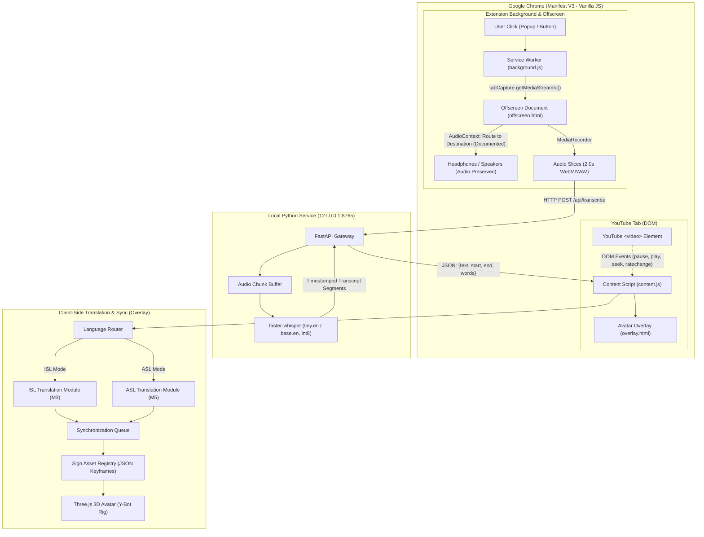

# SignBridge — System Architecture Specification

**Document Version:** 1.1 (Post-Review Corrections)  
**Status:** M0 Conditionally Accepted — Awaiting Human Approval to Begin M1  
**Date:** October 2026

---

## 1. System Overview & Engineering Principles

**SignBridge** is a privacy-first, zero-cost, local-first Chrome extension that translates speech from currently playing browser video (initially YouTube) into synchronized 3D sign-language animation.

### Core Principles
1. **Zero External Runtime Cost:** No paid APIs, cloud services, or subscriptions. All processing executes on local hardware.
2. **Audio-Direct Tab Capture:** Captures audio directly from the active tab via Chrome's documented `chrome.tabCapture` API without microphone dependence, ensuring functionality with or without headphones.
3. **Audible Playback Preservation:** The user must continue to hear the original video audio without muting or distortion.
4. **Independent Language Pipelines:** Indian Sign Language (ISL) and American Sign Language (ASL) are treated as distinct linguistic systems. ISL is implemented first in Milestone M3, followed by ASL in Milestone M5.
5. **Heuristic vs Linguistic Realism:** Word-order heuristics and glossing are recognized as **simplified hypotheses**, not certified sign-language translation. Real linguistic validation requires Deaf-native evaluation.
6. **Vanilla Tooling for Shell:** The Chrome extension shell uses vanilla JavaScript (ES6+) without Node.js, npm, or bundlers for the initial prototype.

---

## 2. High-Level Architecture Diagram



---

## 3. Technology Stack & Component Specifications

| Layer | Implementation Component | Technology Stack | License / Origin | Location | Status |
|---|---|---|---|---|---|
| **Layer 1: Extension Shell** | Manifest V3 Extension | Vanilla JavaScript (ES6+), HTML, CSS | MIT | Chrome Browser | **Code Complete (M1)** |
| **Layer 2: Audio Capture** | `chrome.tabCapture` + Offscreen Doc | Web Audio API (`AudioContext`) | Chrome Extensions API | Offscreen Document | **Code Complete & Verified in Code (M1/M2)** |
| **Layer 3: Local Transcription** | Speech-to-Text Microservice | Python 3.11, FastAPI, `faster-whisper` | MIT | Local Host (`127.0.0.1:8765`) | **IMPLEMENTED — END-TO-END VERIFICATION PENDING (M2)** |
| **Layer 4: Sign Translation** | Rule-Based Heuristic Translators | Vanilla JavaScript | MIT | Content Script / Overlay | **ISL (M3), ASL (M5)** |
| **Layer 5: Sign Asset Registry** | Verified Sign Keyframes | JSON Keyframe Specifications | Clean-Room Project Assets | Extension Assets | **M3 Seed Vocab (0 exist today)** |
| **Layer 6: Avatar Renderer** | WebGL 3D Skeletal Renderer | Three.js + Adobe Mixamo Y-Bot Rig | MIT / Adobe Terms | Injected Overlay (`iframe`) | **Planned M3 (Rig only; no signs)** |
| **Layer 7: Synchronization** | Bounded Queue Sync Controller | Vanilla JavaScript | MIT | Content Script | **Planned M4** |

---

## 4. Layer-by-Layer Architectural Specifications

### Layer 1: Extension Shell (Vanilla JavaScript)
- **Manifest Version:** Chrome Manifest V3 (`manifest.json`).
- **Tooling Decision:** Strictly **vanilla JavaScript**. No Node.js, npm, package.json, TypeScript, or Vite bundler is used for the prototype. The extension directory loads directly as an unpacked extension in Chrome.
- **Permissions:** `tabCapture`, `offscreen`, `activeTab`, `storage`, `scripting`.
- **Host Permissions:** `*://*.youtube.com/*`, `http://127.0.0.1:8765/*`.
- **UI Components:**
  - `popup.html` / `popup.js`: Displays connection health to local Python service, language toggle (defaulting to ISL), explicit Start/Stop capture action, and recognized speech transcription box with clear control.
  - Injected YouTube Floating Panel (M3): Bottom-right container containing the 3D avatar viewport, current gloss caption, and playback status indicators.

### Layer 2: Tab Audio Capture & Playback Preservation (PRD FR-02)

#### 1. Explicit User Activation
Chrome security mandates an explicit user gesture to capture tab media:
- The user clicks "Start Audio Capture" in the popup.
- The service worker invokes `chrome.tabCapture.getMediaStreamId({ targetTabId })` to obtain an ephemeral stream identifier.

#### 2. Offscreen Document Routing
Because Manifest V3 background service workers lack DOM access and cannot host `AudioContext` or `MediaStream` objects, capture executes in an offscreen document:
```javascript
// background.js
await chrome.offscreen.createDocument({
  url: 'offscreen.html',
  reasons: ['USER_MEDIA', 'AUDIO_PLAYBACK'],
  justification: 'Process active tab audio stream without muting playback'
});
chrome.runtime.sendMessage({ type: 'START_CAPTURE', streamId, language });
```

#### 3. Playback Preservation & Audio Slicing Pipeline (Verified in Code)
In `offscreen.js`:
```javascript
const stream = await navigator.mediaDevices.getUserMedia({
  audio: { mandatory: { chromeMediaSource: "tab", chromeMediaSourceId: streamId } }
});

// Primary route: Web Audio API routes audio directly to user speakers/headphones
const audioCtx = new AudioContext();
const source = audioCtx.createMediaStreamSource(stream);
source.connect(audioCtx.destination); // Prevents muting the video!

// Slicing route: Parallel ScriptProcessorNode (4096 buffer)
const processor = audioCtx.createScriptProcessor(4096, 1, 1);
const muteGain = audioCtx.createGain();
muteGain.gain.value = 0; // Prevent acoustic double-playback
source.connect(processor);
processor.connect(muteGain);
muteGain.connect(audioCtx.destination);
```

#### 4. In-Memory PCM WAV Encoding & Slicing
- Every 2.0s of accumulated Float32 audio samples are downsampled from native rate (44.1/48 kHz) to 16,000 Hz.
- Formatted with a standard 44-byte RIFF header into 16-bit linear PCM mono (`audio/wav`, ~64 KB per chunk).
- Enqueued into a bounded FIFO queue (`MAX_QUEUE_SIZE = 3`) with a single-request concurrency lock and 8.0s timeout.

#### 5. Teardown & Error Handling
- When the user stops capture, the tab closes, or navigation occurs:
  1. `stream.getTracks().forEach(track => track.stop())`
  2. `audioCtx.close()`
  3. `chrome.offscreen.closeDocument()`

---

### Layer 3: Local Speech Recognition Service (PRD FR-04 — M2 IMPLEMENTED / INTEGRATION VERIFICATION PENDING)
- **Host:** Local Python FastAPI service at `http://127.0.0.1:8765`.
- **Engine:** `faster-whisper` (CTranslate2 backend, 8-bit integer quantization on CPU).
- **Default Model:** `tiny.en` (`int8` compute type on CPU, 4 CPU threads).
- **Endpoints:**
  - `GET /health` -> `{ status: "ok", service: "signbridge-backend", version: "0.2.0", model, device, compute_type, uptime_seconds }`
  - `POST /api/transcribe` -> accepts multipart form with `audio` (WAV/WebM file), `sequence_id` (int), `timestamp` (float), `language` (optional string). Returns JSON `{ status, sequence_id, timestamp, duration, language, language_probability, text, segments, metrics: { inference_time_ms, rtf, audio_bytes } }`.
- **Empirical Hardware Benchmarks (Intel Core i5-7200U @ 2.50GHz, 16GB RAM):**
  - `tiny.en` (int8, CPU): 1466.2 ms inference for 5.22s audio sample (`test_speech_sample.wav`), **RTF = 0.281** (~560ms per 2.0s chunk, mathematically derived).
  - `base.en` (int8, CPU): 3653.5 ms inference for 5.22s audio sample, **RTF = 0.700** (~1400ms per 2.0s chunk, mathematically derived).
- **Architectural Constraints & Review Notes:**
  1. **Preliminary Benchmark Baseline:** Numbers are measured against a single 5.22s WAV sample; they serve as a preliminary feasibility baseline, not a continuous streaming load benchmark or general Word Error Rate (WER) evaluation.
  2. **Spoken Language vs. Sign Language Scope:** `tiny.en` transcribes English speech only. Selecting ISL or ASL in the extension selects the target sign language for downstream avatar translation; it does **not** adapt the speech recognition engine to spoken Hindi or other vernaculars. Non-English video speech requires multilingual Whisper models (`tiny`/`base`).
  3. **Chunk Boundary Splitting:** Slicing audio into 2.0s chunks creates potential word bisections across chunk boundaries. Overlap handling and transcript merging will be addressed in M3/M4.
  4. **Integration Verification State:** Automated backend and browser in-engine tests pass, but live tab-capture-to-backend integration verification on real YouTube streams remains pending an integration smoke test.
- **Privacy & Security Guarantee:**
  - Bound strictly to `127.0.0.1`.
  - Zero external network requests during transcription (empirically verified in `test_backend.py`).
  - Zero audio written to disk; all audio processed purely in RAM (`BytesIO`).

---

### Layer 4: Language-Specific Translation Engines (PRD FR-05)

#### 4.1 Linguistic Framing as Hypotheses
Sign language translation is fundamentally distinct from text transliteration. Glossing (e.g. converting English sentences to sequences of capitalized words) is a **working heuristic model**, not full sign language. Natural sign languages incorporate rich spatial reference frames, classifier predicates, and grammatical non-manual markers (facial expressions, head tilts) that text glosses cannot fully capture.

#### 4.2 Indian Sign Language (ISL) Engine (Milestone M3)
- **Heuristic Grammar Transformations:**
  - Reorders English Subject-Verb-Object (SVO) structures into Subject-Object-Verb (SOV) order (*"I read book"* -> *"BOOK I READ"*).
  - Fronts temporal adverbs to the sentence beginning (*"YESTERDAY MARKET I GO"*).
  - Moves question words (WH-words) to the sentence terminus (*"YOUR NAME WHAT?"*).
  - Removes English auxiliary verbs (*is, am, are, was, were*) which have no direct morphological equivalent in ISL.
- **Caveat:** These transformations are rule-based hypotheses. Output will be submitted for Deaf-native review.

#### 4.3 American Sign Language (ASL) Engine (Milestone M5)
- Independent module with Topic-Comment grammar and Time-Subject-Object-Verb order.
- Kept strictly decoupled from the ISL pipeline.

#### 4.4 Data Contract (`SignSequence`):
```typescript
interface SignItem {
  gloss: string;                    // Normalized uppercase identifier
  category: 'lexical' | 'fingerspelling' | 'pause';
  durationMs: number;               // Estimated duration
  nonManualMarker?: {
    headTilt?: 'left' | 'right' | 'forward';
    eyebrows?: 'raised' | 'furrowed';
  };
}

interface SignSequence {
  sequenceId: string;
  language: 'ISL' | 'ASL';
  startMediaTimeMs: number;
  endMediaTimeMs: number;
  signs: SignItem[];
  unsupportedWords: string[];       // Explicitly noted for honest reporting
}
```

---

### Layer 5: Sign Asset Registry & 3D Avatar Renderer (PRD FR-06)
- **Avatar Mesh:** Adobe Mixamo `ybot.glb` (2.2 MB).
- **Rigging Distinction:** Y-Bot is a skinned humanoid rig. **It contains zero sign-language animations.**
- **Asset Reality:** **No verified ISL sign animation files exist in the project currently.** 
- **Milestone M3 Asset Strategy:**
  1. Build a clean-room procedural skeletal animation generator for an initial verified seed set (e.g. 10–20 common conversational words such as greetings, pronouns, common verbs).
  2. Implement an A-Z fingerspelling fallback module using standard ISL one-handed/two-handed manual alphabets.
  3. Seamlessly interpolate between poses using Spherical Linear Interpolation (Slerp) on bone quaternions (150ms blend).

---

### Layer 6: Video Synchronization Controller (PRD FR-08)
- **YouTube DOM Hook:** Attaches event listeners to the active `<video>` element on YouTube watch pages.
- **Synchronized Behaviors:**
  - **`pause`:** Immediately pauses avatar animation; freezes current skeletal pose.
  - **`play`:** Resumes animation matching current video playback position.
  - **`seeked`:** Flushes the animation queue; discards all queued sign sequences whose `endMediaTimeMs < video.currentTime * 1000`.
  - **`ratechange`:** Adjusts avatar animation playback speed proportionally (`avatarSpeed = video.playbackRate`).
  - **Queue Overrun Protection:** If transcription delay causes the pending sign queue to lag more than 3.0 seconds behind current video time, older non-essential phrases are pruned to catch up with speech.

---

## 5. Technical Risk Management

| Risk | Classification | Mitigation Strategy |
|---|---|---|
| **Tab Audio Capture Mutes Video** | Critical (Untested) | Route stream through `AudioContext.destination` in offscreen document. Mandatory validation in Milestone M1. |
| **Microphone Dependence** | High | Strictly use `chrome.tabCapture` with `chromeMediaSource: "tab"`. No microphone permissions requested. |
| **Local Transcription Latency** | High (Unverified) | Benchmark `faster-whisper` on target hardware in M2; tune chunk size (2.0s) and quantization (`int8`). |
| **Zero Verified ISL Animations** | Critical | Acknowledge asset deficit; create clean-room seed vocabulary and fingerspelling fallback in M3; submit for Deaf review. |
| **Unlicensed Code Contamination** | Critical | Strictly reject source code from `yap_render_repo` (unlicensed) and `GenASL` (GPLv3). |
| **Animation Desynchronization** | Medium | Video-time bounded queue; auto-prune stale sequences when video seeks or lags > 3s. |
