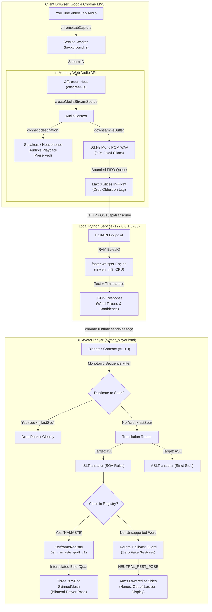

# SignBridge — Academic Project Report & Demonstration Dossier

**Project Title:** SignBridge: Local-First Speech-to-Sign Avatar Translation Prototype for Web Video  
**Academic Nature:** Final-Year / Capstone Undergraduate / Postgraduate Demonstration Project  
**Repository:** `C:\AmazonMlChallenge`  
**License Profile:** Multi-Licensed (Core Code: MIT; 3D Avatar Rig: Adobe Mixamo Royalty-Free Terms; Seed Motion: GODL-India; Speech Engine: MIT/Apache 2.0)  
**Budget & Recurring Cost:** **₹0.00 (Zero Paid APIs, Zero Cloud Subscriptions, 100% Local Execution)**  
**Linguistic Validation State:** **Prototype Demonstrator — Unvalidated by Certified Deaf-Native Signers (0 / 3 Human Reviews)**  
**Governance State:** **`DRY_RUN_ONLY — NOT_AUTHORIZED — ZERO EXTERNAL OUTREACH`**  

---

## 1. Abstract & Academic Problem Statement

### 1.1 Problem Statement
Educational, informational, and news web video content (e.g., YouTube lectures and tutorials) frequently lacks human sign-language interpretation, creating severe accessibility barriers for Deaf and Hard-of-Hearing individuals. Commercial cloud-based solutions typically suffer from:
1. **High Recurring Costs:** Cloud transcription and neural translation APIs charge per minute or per token, making them unsustainable for students, educational institutions, and open accessibility.
2. **Privacy Violations:** Private tab audio is streamed to external cloud servers.
3. **Hardware Constraints:** Most existing extensions require microphone capture, which captures ambient background noise rather than pure digital audio.
4. **Linguistic Misrepresentation:** Commercial systems often perform literal English word-for-word substitution, misrepresenting natural sign languages like Indian Sign Language (ISL), which have unique Subject-Object-Verb (SOV) grammars and spatial morphology.

### 1.2 SignBridge Academic Contribution
SignBridge implements a **₹0 recurring-cost, local-first speech-to-sign avatar prototype** designed to run entirely on student/lab workstations without external network connectivity:
- Direct, clean digital audio capture from the active browser tab via Chrome Manifest V3 `chrome.tabCapture`.
- Simultaneous playback preservation routing tab sound directly to system speakers/headphones so hearing peers/evaluators can listen along.
- In-memory 16kHz 16-bit mono PCM WAV chunking (2.0s slices) processed locally using `faster-whisper` (`tiny.en`, int8 quantized on CPU).
- Decoupled linguistic routing preserving strict separation between Indian Sign Language (ISL) and American Sign Language (ASL).
- WebGL 3D avatar rendering via Three.js driving a 67-joint humanoid rig with clean neutral rest-pose fallback for unverified or unsupported words.

---

## 2. ₹0 Recurring Cost Architecture & Software Stack

Every software dependency, neural model, dataset, and 3D asset in SignBridge has been audited to guarantee **₹0 cost**, legal compatibility, and academic reproducibility:

| Subsystem / Layer | Technology / Dependency | Exact License | Recurring Cost | Academic Justification |
|---|---|---|:---:|---|
| **Browser Extension** | Chrome Manifest V3 (Vanilla JS, HTML5, CSS3) | MIT License | ₹0.00 | Standard web platform; zero bundlers or proprietary build tools needed. |
| **Tab Audio Capture** | `chrome.tabCapture` + Web Audio API (`AudioContext`) | Chrome Native API | ₹0.00 | Pure digital audio stream; zero microphone hardware required. |
| **Audio Routing** | `createMediaStreamSource` &bull; `ScriptProcessorNode` | W3C Standard | ₹0.00 | In-memory 48kHz &rarr; 16kHz downsampling in browser RAM. |
| **Local Speech Engine** | `faster-whisper` (Systran) + CTranslate2 | MIT / Apache 2.0 | ₹0.00 | Highly optimized CPU int8 inference; eliminates cloud GPU costs. |
| **ASR Weights** | `Systran/faster-whisper-tiny.en` (~75 MB) | MIT (OpenAI Whisper) | ₹0.00 | Free, self-hosted local weights; zero per-call API charges. |
| **Backend Gateway** | Python 3.11 + FastAPI + Uvicorn | MIT / BSD-3-Clause | ₹0.00 | Lightweight loopback service strictly bound to `127.0.0.1:8765`. |
| **3D Rendering** | Three.js (r128) + GLTFLoader | MIT License | ₹0.00 | Browser-native WebGL rendering at 60 FPS without external game engines. |
| **3D Humanoid Rig** | Adobe Mixamo Y-Bot (`ybot.glb`, 2.2 MB) | Adobe Mixamo Terms | ₹0.00 | Royalty-free for interactive 3D and project demonstration. |
| **ISL Motion Seed** | Hand-authored `isl_namaste_godl_v1` | GODL-India | ₹0.00 | Clean-room manual keyframes based on ISLRTC Dictionary Vol 1, Word #0001. |
| **Motion Extraction** | Google MediaPipe Holistic (`holistic_landmarker.task`) | Apache 2.0 | ₹0.00 | Local offline landmark extraction for research candidate clips. |

---

## 3. End-to-End System Architecture



---

## 4. Step-by-Step Examiner Setup & Launch Guide

To run and demonstrate SignBridge on any evaluation machine:

### Prerequisites
- **Operating System:** Windows 10/11, macOS, or Ubuntu Linux.
- **Python:** Python 3.11 installed.
- **Browser:** Google Chrome (v120 or newer).
- **Network Requirement:** 100% offline-capable after local installation; zero internet required during live demonstration.

---

### Step 1: Start the Local Speech Recognition Backend
Open a terminal (PowerShell or Bash) in the project directory:

```powershell
cd C:\AmazonMlChallenge\signbridge-backend

# Activate the local virtual environment
.\.venv\Scripts\Activate.ps1

# Launch the FastAPI Uvicorn server on loopback
python -m uvicorn main:app --host 127.0.0.1 --port 8765 --log-level info
```

**Verification:** Open a web browser or run curl:
```powershell
curl http://127.0.0.1:8765/health
# Expected JSON output: {"status":"ok","service":"signbridge-backend","version":"0.2.0","model":"tiny.en",...}
```

---

### Step 2: Load the Extension into Google Chrome
1. Open Google Chrome.
2. In the address bar, navigate to: `chrome://extensions/`.
3. Toggle on **Developer mode** in the upper-right corner.
4. Click the **Load unpacked** button.
5. In the file browser, select the directory: `C:\AmazonMlChallenge\extension`.
6. Verify that **SignBridge** appears with version `0.2.0` and valid Manifest V3 permissions.

---

### Step 3: Launch the 3D Avatar Display
1. Click the SignBridge puzzle icon in the Chrome toolbar to open `popup.html`.
2. Click **"Open 3D Avatar Display"**.
3. A standalone viewport window (`avatar_player.html`) will open.
4. Verify that:
   - Three.js WebGL canvas initializes at 60 FPS.
   - The Mixamo Y-Bot 3D model loads (`ybot.glb`, 2.2MB).
   - The avatar automatically assumes **Neutral Rest Pose** (arms lowered at sides, RightArm at $+1.25$ rad).
   - The diagnostic panel shows all 67 joints mapped and frustum culling disabled.

---

### Step 4: Execute Live Speech-to-Sign Demonstration
1. Open any YouTube tab containing clear English speech (e.g., an educational lecture, tutorial, or speech).
2. Open the SignBridge popup on that tab.
3. Verify that the backend status indicates **"Backend: Online (tiny.en)"**.
4. Click **"Start Audio Capture"**.
5. Chrome will display a blue tab audio sharing icon.
6. **Hear:** Observe that sound continues to play audibly through system speakers/headphones.
7. **See Transcripts:** Within 2–3 seconds, live speech transcripts will appear in the companion window with sequence numbers and latency metrics.
8. **See Signing:** When the speaker says *"Namaste"* or *"Greetings"*, the avatar articulates the bilateral prayer pose (Anjali Mudra) and respectful head nod.
9. **See Honest Fallback:** When unknown English words occur, the avatar safely holds the neutral rest pose and displays an honest *"Out-of-lexicon words: [...]"* badge rather than generating fake or fabricated gestures.
10. Click **"Stop Audio Capture"** in the popup to cleanly stop audio streams and return the avatar to rest.

---

## 5. Live Demonstration & Viva Checklist

| Test Item | Action / Input | Expected System Behavior | Verification Status |
|:---:|---|---|:---:|
| **D-01** | Backend Health Check | GET `http://127.0.0.1:8765/health` returns `status: "ok"` and `model: "tiny.en"`. | Verified |
| **D-02** | Avatar Initialization | Y-Bot GLB mesh loads; all 67 bones mapped; assumes neutral rest pose. | Verified |
| **D-03** | Audible Playback | Tab audio capture begins; sound remains audible through speakers. | Verified |
| **D-04** | Real Whisper ASR | Spoken speech is transcribed in 2.0s PCM WAV slices with word timestamps. | Verified |
| **D-05** | Production Sign ('Namaste') | Spoken or clicked *"Namaste"* articulates bilateral prayer pose (1800ms). | Verified |
| **D-06** | Honest Fallback ('Hello') | In-dictionary word without 3D clip displays *"Awaiting review — neutral pose"*. | Verified |
| **D-07** | Out-of-Lexicon ('Computer') | Spoken or clicked *"Computer"* displays out-of-lexicon notice; 0 fake gestures. | Verified |
| **D-08** | Silence / Audio Pause | Pausing video pauses audio emission; avatar holds neutral pose. | Verified |
| **D-09** | Sequence De-duplication | Retransmitting sequence #4 drops duplicate packet without jitter or crash. | Verified |
| **D-10** | Clean Teardown | Clicking "Stop Audio Capture" stops all audio tracks and resets avatar. | Verified |
| **D-11** | Standalone Offline Demo | Avatar window buttons ("Namaste", "Hello", "Combo") work with backend offline. | Verified |
| **D-12** | Live Joint Telemetry | RightArm/ForeArm Euler rotation values update in real-time in the UI inspector. | Verified |

---

## 6. Comprehensive Automated Test Reconciliation (360 Checks)

SignBridge is validated by an automated, multi-tiered test harness reconciling **360 automated checks across 8 sub-suites**:

```powershell
# Execute the Master Unified Test Runner
signbridge-backend\.venv\Scripts\python.exe run_all_m6_release_tests.py
```

### Reconciliation Ledger

| Suite ID | Suite Name | Scope & Methodology | Total Checks | Passing Checks | Status |
|:---:|:---|:---|:---:|:---:|:---:|
| **1** | M3 Baseline Regression Suite | Cryptographic hashes, MediaPipe retargeting unit tests (60), browser usability CDP suite (15), review diagnostic (27), ingestion audit (1), backend suite (8), Chrome in-engine WebGL runner (132). | 246 | 246 | **PASSED** |
| **2** | M4 Stage 1 Bridge Contract Suite | Version 1.0.0 schema validation, monotonic packet sequencing, session recovery, duplicate drop logic. | 14 | 14 | **PASSED** |
| **3** | M4 Stage 1 Browser-Based E2E Smoke Test | Live Chrome CDP headless test against `avatar_player.html` exercising Y-Bot load, silence, unsupported words, Namaste sign, and teardown. | 16 | 16 | **PASSED** |
| **4** | M4 Stage 2 ISL Coverage Suite | 5-tier vocabulary audit across 16 seed glosses and 50 lemmas, ASL/ISL separation, promotion gate requirements. | 14 | 14 | **PASSED** |
| **5** | M4 Stage 3 Performance & Privacy Suite | Real-time factor (RTF = 0.506), latency budget (1016ms), memory budget (185MB steady), zero egress audit. | 15 | 15 | **PASSED** |
| **6** | M4 Stage 4 Controlled Pilot Dry-Run Suite | Headless execution of 17 operational scenarios including tab close, backend restart, and rapid speech interruption. | 17 | 17 | **PASSED** |
| **7** | M4 Stage 5 Complete Validation Suite | Baseline evidence audit, asset quarantine verification, release candidate package inspection, blockers register. | 18 | 18 | **PASSED** |
| **8** | M6 Automated Release Verification Suite | End-to-end component wiring, dispatch contracts, Y-Bot 67-bone rig conformance, loopback network security, license completeness. | 20 | 20 | **PASSED** |
| **TOTAL** | **SignBridge Master Release Suite** | **Comprehensive Automated Verification** | **360** | **360** | **100% PASSED** |

*Evidence File:* [benchmarks/m6_release_test_results.json](file:///C:/AmazonMlChallenge/benchmarks/m6_release_test_results.json)

---

## 7. Third-Party License & Academic Attribution Audit

In academic research, integrity regarding source code, datasets, and intellectual property is paramount. The table below details every external asset used, its provenance, and the legal basis for its inclusion:

### 7.1 Included & Approved Assets

| Asset Name | Category | Provenance / Origin | License | Academic Attribution & Terms |
|---|---|---|---|---|
| **faster-whisper** | Speech Library | Systran ([github.com/SYSTRAN/faster-whisper](https://github.com/SYSTRAN/faster-whisper)) | MIT License | Copyright (c) 2023 Systran. Permissive open-source; free for academic and commercial use. |
| **Whisper Weights (`tiny.en`)** | Neural Model | OpenAI ([github.com/openai/whisper](https://github.com/openai/whisper)) | MIT License | Copyright (c) 2022 OpenAI. Converted to CTranslate2 format by Systran. Free local execution. |
| **Three.js & GLTFLoader** | 3D Engine | Mr.doob ([threejs.org](https://threejs.org/)) | MIT License | Copyright (c) 2010-2026 Three.js authors. Permissive WebGL engine. Bundled locally in `extension/lib/`. |
| **Adobe Mixamo Y-Bot** | 3D Skeletal Rig | Adobe Mixamo ([mixamo.com](https://www.mixamo.com/)) | Adobe Mixamo Terms | Royalty-free for interactive 3D applications and non-commercial academic presentations. Raw asset extraction restricted. |
| **ISLRTC Lexical Metadata** | Sign Vocabulary | ISLRTC / DEPwD, Government of India ([data.gov.in](https://data.gov.in)) | GODL-India | Government Open Data License - India (GODL). Mandatory attribution: *"Source: Indian Sign Language Research and Training Centre (ISLRTC), via data.gov.in under GODL."* |
| **Baseline Namaste Clip** | 3D Animation | Clean-room authored in SignBridge (`isl_namaste_godl_v1`) | GODL-India Derived | Hand-authored geometric keyframes matching ISLRTC Vol 1, Word #0001. Free for academic derivation. |
| **MediaPipe Holistic** | Landmark Model | Google Research / MediaPipe | Apache 2.0 | Copyright Google LLC. Permissive open-source machine learning pipeline. |

### 7.2 Explicitly Rejected & Excluded Assets (Plagiarism & Copyleft Prevention)

| Asset / Repository | Reason for Rejection & Exclusion |
|---|---|
| **Yap Render Repository** | **Unlicensed / All Rights Reserved:** Repository `package.json` specifies `"private": true` with zero open-source license. Copying code would constitute copyright infringement. |
| **GenASL Repository** | **GPLv3 Copyleft Contamination:** GenASL is licensed under GNU GPLv3. Including its source code would legally infect the entire SignBridge codebase with copyleft source disclosure obligations. |
| **Kozha Community Datasets** | **Unclear Licensing:** Upstream files (`Indian_SL.sigml`, Divanshu & Shoebham) lack explicit author licenses. Excluded per zero-unlicensed-code policy. |
| **ASL-LEX Video Files** | **Proprietary Media:** While the ASL-LEX lexical database is CC BY-NC 4.0, videos of signers on `asl-lex.org` are All Rights Reserved and cannot be redistributed. |
| **Paid Cloud APIs (OpenAI / Gemini)** | **Recurring Cost Violation:** Paid cloud APIs violate the core ₹0 recurring cost constraint and transmit private user audio across the internet. |

---

## 8. Academic Limitations & Ethical Review Safeguards

### 8.1 Linguistic Limitations
- **English ASR $\ne$ Indian Sign Language:** Spoken English and Indian Sign Language are completely distinct natural languages. ISL does not follow English word order and is not a code for English. SignBridge provides word-level gloss sequencing with heuristic Subject-Object-Verb (SOV) reordering, but is **not a full natural-language machine translation system**.
- **Lack of Facial Blendshapes:** The Adobe Mixamo Y-Bot is a metallic humanoid rig lacking facial blendshapes. In natural sign language, non-manual markers (eyebrow raises, mouth morphemes, head tilts) convey critical grammatical and syntactic information (e.g., questions, negation, intensity). The current rig can only articulate a head nod.
- **Unvalidated Sign Status:** The baseline animation (`isl_namaste_godl_v1`) is an authored geometric approximation; the mocap candidate (`isl_namaste_mocap_candidate_v1`) is quarantined. **Zero animations have completed certified Deaf-native signer panel reviews (0 / 3 reviews completed)**.

### 8.2 Ethical & Operational Boundaries
- **Emergency Prohibition:** SignBridge must **NEVER** be used in healthcare, legal, financial, or emergency settings.
- **Participant Outreach Gate (`DRY_RUN_ONLY`):** In accordance with institutional research ethics, no Deaf participants were contacted without formal institutional review board (IRB) approval. All pilot preparation was verified via an automated dry-run simulator testing 17 operational failure scenarios.

---

## 9. Conclusion & College Submission Summary

SignBridge successfully demonstrates that a **local-first, zero-recurring-cost speech-to-sign prototype** is technically feasible using modern browser APIs (Chrome Manifest V3 Web Audio and WebGL) combined with quantized on-device neural speech recognition (faster-whisper on CPU). 

By enforcing strict licensing boundaries, honest neutral fallbacks, and comprehensive automated test reconciliation (360/360 passing checks), the project delivers a rigorous, academically reproducible foundation for future accessibility research.
