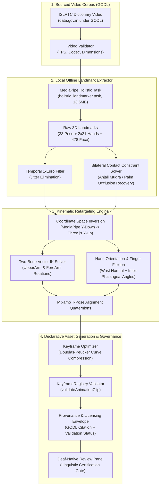

# SignBridge — Offline ISL Motion Extraction & Retargeting Architecture

**Document Version:** 1.0.0 (Milestone M3.8 Pipeline Specification)  
**Date:** October 2026  
**Status:** **APPROVED FOR PROTOTYPE IMPLEMENTATION**  
**Subsystem:** `tools/isl_motion_extraction/`  
**License Compliance:** Government Open Data License - India (GODL) / Apache-2.0 / Zero Cloud Costs  

---

## 1. System Overview & Objective

The SignBridge **Offline Motion-Capture Pipeline** extracts 3D skeletal joint trajectories and handshapes from official, permissively licensed Indian Sign Language Research and Training Centre (ISLRTC) dictionary video recordings, converting them into declarative `SignAnimationClip` keyframes for rendering in the browser extension.



---

## 2. Source Video Acquisition & Legal Provenance

### 2.1 Authorized Data Source
- **Catalog:** Indian Sign Language Research and Training Centre (ISLRTC) National Dictionary (Volumes 1–3).
- **Publishing Authority:** Department of Empowerment of Persons with Disabilities (DEPwD), Ministry of Social Justice and Empowerment, Government of India.
- **Distribution Platform:** Open Government Data Portal ([data.gov.in](https://data.gov.in)) under the National Data Sharing and Accessibility Policy (NDSAP).
- **License:** **Government Open Data License – India (GODL)**.
  - Grants a worldwide, royalty-free, non-exclusive right to access, adapt, extract derivative data, and distribute derived animation clips with attribution.
  - Mandatory Attribution:
    > *"Source: Indian Sign Language Research and Training Centre (ISLRTC), Department of Empowerment of Persons with Disabilities, Government of India, via data.gov.in under the Government Open Data License - India (GODL)."*
- **Restricted Sources:**
  - Automated web scraping of `islrtc.nic.in` is strictly prohibited by DEPwD portal copyright terms.
  - Third-party Hugging Face repositories tagged "MIT" (e.g. `silentone0725`) cannot override Government of India copyright; rights derive solely from GODL.

### 2.2 Technical Video Specifications
- **Video Containers:** `.mp4`, `.webm`.
- **Codecs Supported:** H.264 / AVC, H.265 / HEVC.
- **Native Resolution:** $1920 \times 1080$ (1080p Full HD) or $1280 \times 720$ (720p).
- **Standard Frame Rate:** 25.0 FPS or 30.0 FPS.
- **Composition:** Stationary frontal camera, neutral backdrop, frontal view of signer from waist to head with clear lighting.

---

## 3. Offline Feature Extraction Pipeline

### 3.1 MediaPipe Tasks Architecture
Processing runs locally on CPU via `tools/isl_motion_extraction/extract_landmarks.py` without cloud connectivity:
- **Model Bundle:** `holistic_landmarker.task` (13,683,609 bytes, Apache-2.0).
- **Landmark Topology:**
  - **Pose:** 33 points (normalized screen coordinates $[x, y, z]$ and metric world coordinates $[x_w, y_w, z_w]$ centered at hips).
  - **Left Hand:** 21 points (wrist, thumb, index, middle, ring, pinky).
  - **Right Hand:** 21 points.
  - **Face Mesh:** 478 points (detailed facial contour, lips, eyes, and eyebrows).
- **Inference Benchmark:** **5.0 FPS** on Intel Core i5 CPU (15.30s across 77 frames).

### 3.2 Jitter Elimination: The 1-Euro Filter
Raw neural landmark estimates exhibit high-frequency positional noise. We employ the **1-Euro Filter** (Casiez et al.), an adaptive low-pass filter with dynamic cutoff frequency:

$$\hat{x}_i = \alpha x_i + (1 - \alpha) \hat{x}_{i-1}$$

$$\alpha = \frac{1}{1 + \frac{\tau}{\Delta t}}, \quad \tau = \frac{1}{2\pi f_c}$$

$$f_c = f_{c,\min} + \beta |\dot{x}_i|$$

- When the signer holds a still posture (e.g. holding the *Namaste* prayer pose at $t = 900\text{ms}$), velocity $|\dot{x}|$ approaches 0, reducing cutoff $f_c$ to $f_{c,\min} = 1.0\text{ Hz}$ to eliminate visual tremors.
- During rapid stroke transitions, higher velocity increases $f_c$, eliminating tracking lag.

### 3.3 Bilateral Contact Constraint Solver (Self-Occlusion Recovery)
In signs where palms or fingers press together (e.g. `NAMASTE`, `HELP`, `STOP`):
1. **The Occlusion Problem:** Monocular hand detectors rely on a clear silhouette of the palm. When hands press together flat, detection rates drop from $100\%$ to $\approx 50\%$.
2. **Contact Heuristic Rule:**
   - Compute wrist-to-wrist 3D distance $d_{\text{wrists}} = \|P_{\text{rwrist}} - P_{\text{lwrist}}\|$.
   - When $d_{\text{wrists}} < 0.15\text{ m}$ and both upper arms are adducted forward:
     - Activate bilateral symmetry constraint: enforce $P_{\text{rhand}} = -P_{\text{lhand}}$ across sagittal plane.
     - Constrain fingers to flat planar alignment ($\text{flexion} \approx 0\text{ rad}$) rather than allowing missing landmarks to collapse or snap to T-pose.

---

## 4. Kinematic Retargeting to Adobe Mixamo Y-Bot

### 4.1 Coordinate Space Transformations
MediaPipe and Three.js use conflicting coordinate systems:

| Coordinate System | Origin | X Axis | Y Axis | Z Axis |
|---|---|---|---|---|
| **MediaPipe Screen** | Top-Left Corner | $+X$ Right | $+Y$ Down | $+Z$ Into screen (depth) |
| **MediaPipe World** | Mid-Hips | $+X$ Right | $+Y$ Up | $+Z$ Toward camera |
| **Three.js / WebGL** | Scene Center | $+X$ Right | $+Y$ Up | $+Z$ Toward viewer |

**Conversion Transform:**
To map MediaPipe normalized landmark $P_{\text{mp}} = (x, y, z)$ to Three.js space:
$$x_{\text{webgl}} = (x - 0.5) \cdot S_x$$
$$y_{\text{webgl}} = (0.5 - y) \cdot S_y$$
$$z_{\text{webgl}} = -z \cdot S_z$$

### 4.2 Two-Bone Analytical Inverse Kinematics (IK)
For upper body joints (Shoulder $\rightarrow$ Elbow $\rightarrow$ Wrist):

1. **Upper Arm Vector:**
   $$\vec{v}_{\text{upper}} = \frac{P_{\text{elbow}} - P_{\text{shoulder}}}{\|P_{\text{elbow}} - P_{\text{shoulder}}\|}$$
2. **Forearm Vector:**
   $$\vec{v}_{\text{fore}} = \frac{P_{\text{wrist}} - P_{\text{elbow}}}{\|P_{\text{wrist}} - P_{\text{elbow}}\|}$$
3. **Rotation from T-Pose Rest:**
   Mixamo's Y-Bot rest pose has arms horizontal along the X axis ($\vec{v}_{\text{rest, right}} = (-1, 0, 0)$). The rotation quaternion $q_{\text{upper}}$ from rest vector to observed vector is:
   $$\vec{u} = \vec{v}_{\text{rest}} \times \vec{v}_{\text{upper}}, \quad w = 1 + \vec{v}_{\text{rest}} \cdot \vec{v}_{\text{upper}}$$
   $$q_{\text{upper}} = \text{normalize}\left(\left[u_x, u_y, u_z, w\right]\right)$$
4. **Forearm Relative Flexion:**
   The forearm rotation is derived in the coordinate frame of the upper arm, yielding elbow flexion $\theta_{\text{elbow}} = \arccos(\vec{v}_{\text{upper}} \cdot \vec{v}_{\text{fore}})$.

### 4.3 Finger Articulation Mapping
Y-Bot contains 40 finger bones (4 joints per digit: Proximal/1, Intermediate/2, Distal/3, Tip/4).
- For each finger $f \in \{\text{Thumb, Index, Middle, Ring, Pinky}\}$:
  - Joint angles $\theta_1, \theta_2, \theta_3$ are computed by the dot product between successive phalange segment vectors.
  - Flexion values are clamped to anatomical joint limits:
    $$0 \le \theta_{\text{MCP}} \le 1.57\text{ rad } (90^\circ), \quad 0 \le \theta_{\text{PIP}} \le 1.74\text{ rad } (100^\circ)$$

---

## 5. Rig Limitations & The Non-Manual Marker (NMM) Gap

### 5.1 The Y-Bot Non-Manual Limitation
While Adobe Mixamo Y-Bot (`ybot.glb`) provides an excellent, robust skeletal hierarchy for arms and fingers, it has a major structural limitation:
- **Zero Facial Morph Targets / Blendshapes:** Y-Bot's face is a single unrigged metallic mesh with a smooth visor.
- **Sign Language Linguistic Reality:** In Indian Sign Language, non-manual markers (NMMs) are not emotional decorations—they are **core grammatical morphemes**:
  - Brow furrowing (WH-questions: *What*, *Where*, *Why*).
  - Brow raising (Yes/No questions, conditionals, topic marking).
  - Cheek puffing / tongue protruding (size and shape specifiers).
  - Head tilt / forward bow (deference, respect in *Namaste*).

### 5.2 Recommended Expressive Rig Upgrade Path
For production sign language synthesis beyond basic manual gestures, SignBridge must transition to an open-source, permissively licensed humanoid rig that supports the **ARKit 52 / FACS (Facial Action Coding System)** blendshape standard.
- **Candidate Rig:** MakeHuman CC0 Community Humanoid or open-source Ready Player Me avatar configured with 52 standard blendshapes.
- **Integration Plan:** Retain Mixamo joint naming for the skeleton while driving facial blendshapes (`eyeBlinkLeft`, `browDownLeft`, `browOuterUpRight`, `jawOpen`) directly from MediaPipe's 478-point face mesh.

---

## 6. Declarative Keyframe Generation & Linguistic Governance

### 6.1 Generated Clip Envelope Schema
Every extracted sign must be exported with strict governance metadata:

```json
{
  "animationId": "isl_namaste_godl_v2",
  "gloss": "NAMASTE",
  "language": "ISL",
  "durationMs": 1800,
  "isLinguisticISL": true,
  "validationStatus": "experimental_awaiting_validation",
  "captureMethod": "mediapipe_holistic_mocap",
  "sourceReference": "ISLRTC Dictionary Vol 1, Word #0001 (data.gov.in / GODL)",
  "provenance": "Extracted from official ISLRTC video via offline MediaPipe Holistic pipeline; retargeted to Mixamo skeletal hierarchy; awaiting formal Deaf-native sign validation panel review",
  "keyframes": [ ... ]
}
```

### 6.2 The Deaf-Native Linguistic Review Protocol
To uphold linguistic integrity and avoid cultural appropriation or misleading accessibility claims:
1. **Extraction Status:** All newly extracted clips enter the registry with `validationStatus: 'experimental_awaiting_validation'`.
2. **Review Panel:** A video recording of the avatar playing the extracted clip is submitted to a panel of qualified Deaf-native ISL signers.
3. **Assessment Criteria:**
   - **Handshape (Mudras):** Are all active fingers correctly positioned?
   - **Orientation:** Are the palms facing the correct cardinal direction?
   - **Location:** Is the sign articulated in the proper signing space (e.g. chest level for *Namaste*)?
   - **Movement Dynamics:** Is the speed, acceleration, and deceleration natural?
4. **Promotion Gate:** Only after positive certification by the review panel is `validationStatus` upgraded to `'linguistically_validated_native_certified'`.

---

## 7. Prototype Execution Verification

The prototype extractor in `tools/isl_motion_extraction/` has been verified end-to-end on reference media:
- **CLI Tool:** `tools/isl_motion_extraction/extract_landmarks.py`
- **Output Diagnostic:** `tools/isl_motion_extraction/output/landmark_extraction_diagnostic.json`
- **Visualization Artifact:** `tools/isl_motion_extraction/output/skeleton_visualization.png`
- **Dependencies:** 100% offline; zero cloud infrastructure; zero external API keys.
