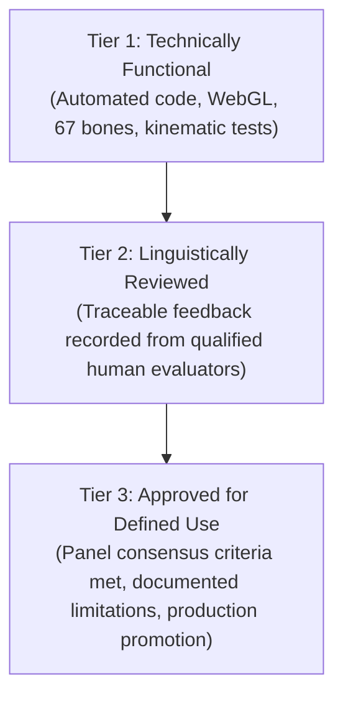

# Indian Sign Language (ISL) Reviewer Handoff Package

**Candidate Identifier:** `isl_namaste_mocap_candidate_v1`  
**Candidate Version:** `1.0.0-experimental`  
**Target Sign / Gloss:** `NAMASTE`  
**Milestone:** SignBridge M3.17 (Review Protocol Finalization & External Reviewer Handoff)  
**Date:** October 2026  
**Status:** **EXPERIMENTAL — Awaiting Qualified Human Review. Not Linguistically Validated.**

---

> [!CAUTION]
> **UNVALIDATED EXPERIMENTAL ANIMATION**  
> This 3D animation candidate was generated via an automated monocular computer-vision motion-capture pipeline (MediaPipe Holistic retargeted to Mixamo Y-Bot rig). It has **NOT** been validated by any Deaf native signer, certified ISL interpreter, or linguistics authority. It must not be deployed in production or represented as an authoritative translation until genuine human review and consensus approval are completed.
>
> **Evaluator Independence:** The evaluator must assess the sign completely independently. Do not assume the avatar is correct. You are fully empowered to reject the sign, flag unnatural movement, or indicate uncertainty.

---

## 1. Cryptographic Identifiers & Provenance

To guarantee that review feedback is bound to the exact data evaluated and cannot be attributed to modified or different files, verify the following cryptographic checksums:

| Asset | Identifier / Relative Path | Expected SHA-256 Checksum |
| :--- | :--- | :--- |
| **Animation Candidate (Tooling)** | `tools/isl_motion_extraction/output/isl_namaste_mocap_candidate_v1.json` | `6f24e60f7f55d71482133790ca60f6a52682a38f7f6b32c8921480586cef4a46` |
| **Animation Candidate (Extension)** | `extension/assets/animations/isl_namaste_mocap_candidate_v1.json` | `6f24e60f7f55d71482133790ca60f6a52682a38f7f6b32c8921480586cef4a46` |
| **Reference Video** | `tools/isl_motion_extraction/reference_videos/ISLRTC_Namaste_sample.mp4` | `129811572acc6a236fb62b4ade143df8770b7fdcc5249d5facffc349b16a18b8` |
| **Review Studio UI** | `tools/isl_motion_extraction/preview_mocap.html` | Client-side HTML/JS side-by-side inspection studio |

### Candidate Technical Parameters
- **Duration:** 3.08 seconds (77 frames at 25 FPS)
- **Rig Structure:** 67 bones (Mixamo standard humanoid skeleton)
- **Channels:** Per-bone local rotation quaternions `[qx, qy, qz, qw]` and root translation `[tx, ty, tz]`
- **Coordinate Space:** Right-handed WebGL (+X right, +Y up, +Z forward)

---

## 2. Purpose & Review Scope

SignBridge is an open-source, local-first assistive tool designed to translate spoken and captured audio into Indian Sign Language avatar representations.

The goal of this review session is to evaluate whether the automated computer-vision motion reconstruction accurately reproduces the lexical form of **NAMASTE** as performed in the reference video, identify kinematic/linguistic discrepancies, and document actionable feedback for algorithmic retargeting improvements.

### Review Scope Boundaries
- **In Scope:** The single sign `NAMASTE` as rendered on the 3D humanoid avatar compared against the reference performance.
- **Out of Scope:** Broader continuous ISL grammar, non-lexical conversational discourse, facial emotion rendering (unavailable on current avatar), and audio transcription accuracy.

---

## 3. Known Technical Limitations

Reviewers must be aware of the following physical and tracking limitations before scoring:

1. **Monocular Hand Occlusion & Symmetry Discrepancies:**
   - In 2D frontal video of bilateral signs where palms touch (such as the Anjali Mudra / prayer posture in Namaste), the two hands occlude each other in monocular perspective.
   - MediaPipe Holistic tracked full pose with 100% frame availability, but simultaneous bilateral hand tracking was achieved on only ~49.4% of frames.
   - Flagged frames (Frames 22, 59, 62) exhibit heuristic wrist proximity coupling and temporal interpolation. Reviewers should pay particular attention to whether the hands lift, meet, and part naturally.

2. **Unavailable Facial Blendshapes:**
   - The Mixamo Y-Bot mesh has articulated fingers and full body skeletal joints, but **lacks facial blendshapes** (eyes, eyebrows, mouth, and jaw are static).
   - ISL non-manual markers (NMMs) conveyed by facial expression are **Not Assessable** on this avatar rig. Head tilt is articulated and assessable.

3. **Rest-to-Sign Transition:**
   - Frame range 0–21 represents lap rest.
   - Frame range 22–24 represents upward stroke transition.
   - Frame range 25–58 represents constrained palm contact hold.
   - Frame range 59–76 represents parting release and return to lap rest.

---

## 4. Linguistic Review Dimensions & Instructions

Reviewers evaluate five distinct linguistic dimensions using four standardized qualitative findings:

| Dimension | Scope of Evaluation | Guiding Questions |
| :--- | :--- | :--- |
| **1. Handshape** | Finger extension, flexion, adduction, and thumb orientation on both hands. | Are fingers cleanly aligned and pressed together? Do the fingers look natural or distorted? |
| **2. Location** | Spatial positioning of hands relative to chest/torso signing space. | Are hands positioned centrally in front of the chest/sternum, not too high (neck) or too low (waist)? |
| **3. Orientation** | Palm facing direction and wrist angle relative to the body. | Are palms facing each other vertically? Are the wrists bent at an anatomically natural angle? |
| **4. Movement** | Onset trajectory, stroke contact/hold duration, and release trajectory. | Is the movement smooth and deliberate? Is there a perceptible hold at the peak of the greeting? |
| **5. Non-Manual Features** | Forward head tilt during hold. *(Rig Limitation: Facial expressions must be marked Not Assessable).* | Is the slight bow/inclination of the head natural during hold? |

### Finding Options (Equally Prominent)
- **Acceptable:** Movement accurately conforms to standard ISL articulation.
- **Minor Issue:** Noticeable inaccuracy or stiffness that does not destroy intelligibility.
- **Unacceptable:** Incorrect or ungrammatical movement that distorts meaning or looks unnatural.
- **Not Assessable:** Cannot be evaluated due to documented rig or capture constraints (e.g., facial blendshapes on Y-Bot).

---

## 5. Reviewer Setup & Inspection Workflow

### Step 1: Open the Review Studio
1. Launch a local web server from the project root (`C:\AmazonMlChallenge`):
   ```powershell
   python -m http.server 8080
   ```
2. In Google Chrome, navigate to:
   ```
   http://localhost:8080/tools/isl_motion_extraction/preview_mocap.html
   ```

### Step 2: Load the Media Assets
1. **Load Reference Video:** Click **Load Reference Video** and select:
   `tools/isl_motion_extraction/reference_videos/ISLRTC_Namaste_sample.mp4`
2. **Load Candidate Animation:** The candidate JSON is automatically fetched by default. If loading manually, click **Load Custom JSON** and select:
   `tools/isl_motion_extraction/output/isl_namaste_mocap_candidate_v1.json`
3. Verify that the studio displays the candidate SHA-256 checksum and confirms schema validity (`Status: Loaded & Verified`).

### Step 3: Inspect Playback & Flag Critical Frames
1. **Side-by-Side Playback:** Press **Play / Pause** (`Spacebar`) to inspect synchronous playback of video and avatar.
2. **Variable Speeds:** Test at `1.0x` (normal speed) and `0.5x` or `0.25x` (slow motion) to inspect hand contact and finger articulation.
3. **Orbit Controls:** Left-click and drag on the 3D viewport to inspect the avatar from the front, 45-degree angle, and side profile.
4. **Flagged Frame Inspection:**
   - **Frame 22 (880ms: Lift Stroke):** Initial upward lift from lap rest.
   - **Frame 40 (1600ms: Palm Contact):** Peak prayer hold at sternum height.
   - **Frame 59 (2360ms: Hand Separation):** Parting release.
   - **Frame 62 (2480ms: Lap Return):** Descent return to resting position.
   - Use the **Step Forward / Backward** buttons or scrubber to inspect individual frames.

### Step 4: Record & Export Feedback
1. Fill out the **Linguistic Evaluation** form on the right-hand panel of the studio:
   - **Step 1 (Open-Ended Observations):** Record spontaneous impressions, kinematic stiffness, posture, cultural nuance, or initial thoughts in your own words before scoring discrete categories.
   - **Step 2 (Parameter Ratings):** Assign findings (`Acceptable`, `Minor Issue`, `Unacceptable`, `Not Assessable`) for Handshape, Location, Orientation, Movement, and Non-Manuals.
   - **Step 3 (Interval Scrutiny):** Check Frames 22, 59, 62 if transitions appear acceptable, or leave unchecked if distorted.
   - **Step 4 (Uncertainty / Evidence Request):** Check **Declare Uncertainty / Request Further Evidence** if camera perspective, video resolution, or rig limits prevent a confident evaluation.
   - **Step 5 (Overall Recommendation):** Select one of four verdicts:
     - `Provisional Approval for Further Review` (Eligible for broader panel review; **NOT approved for production**).
     - `Requires Revisions / Tuning` (Kinematic or linguistic adjustments needed).
     - `Rejected` (Unacceptable or misleading ISL representation).
     - `Not Assessable / Inconclusive` (Insufficient evidence or rig limitations prevent assessment).
2. Click **Export Review JSON**.
   - The studio downloads a structured JSON file named `ISL_Namaste_Review_<ReviewerName>_<YYYY-MM-DD>.json`.
   - The file automatically binds your scores to the active candidate and reference video SHA-256 hashes.
3. *Optional Markdown Form:* If preferred by the reviewer, complete the fillable template at `Docs/ISL_REVIEW_FEEDBACK_TEMPLATE.md` or click **Export Review Markdown**.

### Step 5: Returning Review Artifacts
Submit the exported review JSON file (and optional markdown notes) via one of:
- Save directly into project directory: `tools/isl_motion_extraction/reviews/`
- Transmit to the project development team via the agreed offline review repository.

---

## 6. The Three-Tier Validation Framework

To ensure ethical reporting, SignBridge strictly delineates three levels of validation. Reaching one tier does not imply meeting the next:



1. **Technically Functional:**
   - The animation JSON parses, adheres to the sign clip contract, loads into Three.js, renders at 60 FPS, and satisfies all 25 automated pipeline checks.
   - *Current status of `isl_namaste_mocap_candidate_v1`: **ACHIEVED**.*

2. **Linguistically Reviewed:**
   - One or more qualified ISL signers have executed the handoff protocol, inspected side-by-side playback, and generated traceable review records bound to the candidate's SHA-256 hash.
   - *Current status: **PENDING REVIEW** (Handoff package ready).*

3. **Approved for a Defined Use:**
   - Review panel consensus achieves agreement on critical parameters (Handshape, Orientation, Location, and Movement rated `Acceptable`, Non-Manual limits documented, overall verdict `Provisional Approval` affirmed by multiple reviewers), known limitations are formally documented, and sign language community representatives approve promotion.
   - *Current status: **NOT APPROVED** (Production continues using baseline `isl_namaste_godl_v1`).*

---

## 7. Data Privacy & Local-First Isolation

- **Zero Cloud Calls:** The review studio runs 100% locally in the browser using WebGL and local file APIs. No video frames, keystrokes, or evaluation scores are transmitted across any network.
- **Data Integrity Protection:** The studio compares candidate hashes upon import. If an imported review JSON references a different candidate SHA-256, it displays a high-visibility warning and blocks accidental misattribution.
- **Baseline Isolation:** Reviewing this experimental candidate does not modify the active SignBridge Chrome extension production baseline.
