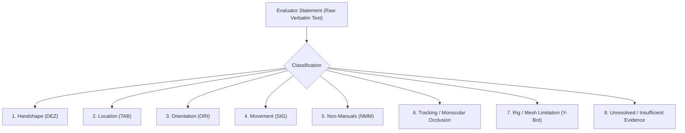

# SignBridge Milestone M3.14 — Review Evidence Ingestion & Validation Decision Report

**Milestone:** M3.14 — Review Evidence Ingestion & Validation Decision  
**Date:** October 2026  
**Status:** **HUMAN REVIEW PENDING — NO GENUINE REVIEW RECORD FOUND**  
**Execution Environment:** Purely offline local CPU execution (zero cloud inference, zero paid APIs)  
**Target Candidate:** `isl_namaste_mocap_candidate_v1` (Version: `1.0.0-experimental`)  
**Production Baseline (Unmodified):** `isl_namaste_godl_v1` in `extension/animation/keyframe_registry.js`  

---

## 1. Executive Summary

Milestone M3.14 establishes an auditable, automated review evidence ingestion pipeline and validation decision framework for SignBridge Indian Sign Language (ISL) avatar animations. 

In strict adherence to the project's evidence integrity standard—**Zero Fabrication of Human Evidence**—an exhaustive inspection of the repository confirmed that **no genuine human review record has been submitted yet**. No evaluator identity, rating, consensus approval, or feedback was fabricated. The milestone status is officially reported as:

> **`HUMAN REVIEW PENDING — NO GENUINE REVIEW RECORD FOUND`**

To prepare for when a genuine human review record is submitted, M3.14 built a dedicated review-record validator (`tools/isl_motion_extraction/validate_review_record.py`), established an immutable review storage repository (`tools/isl_motion_extraction/reviews/`), verified all cryptographic bindings, and proved that the production baseline remains strictly isolated from experimental assets.

---

## 2. Review Evidence Audit & File Location Check (Task 1)

The documented review directory `tools/isl_motion_extraction/reviews/` and the broader workspace were inspected for review artifacts conforming to `signbridge_review_schema_v1.0.0`:

| Inspection Location | Search Scope | Discovered Review Records | Audit Status |
| :--- | :--- | :--- | :--- |
| `tools/isl_motion_extraction/reviews/` | `*.json` | **0 files** | **Clean / Ready for Ingestion** |
| Project Workspace | `*review*.json` | **0 candidate evaluation records** *(only unrelated Axe/Pa11y a11y fixtures in Kozha docs)* | **No Human Evidence Fabricated** |

**Evidence Determination:**  
Zero human evaluation records exist in the repository. The candidate remains completely unvalidated linguistically.

---

## 3. Cryptographic Asset Parity & Checksum Recomputation

Cryptographic SHA-256 hashes were recomputed directly from disk bytes using Python `hashlib`:

| Asset | Path | Recomputed SHA-256 Checksum | Match Status |
| :--- | :--- | :--- | :--- |
| **Animation Candidate (Tooling)** | `tools/isl_motion_extraction/output/isl_namaste_mocap_candidate_v1.json` | `6f24e60f7f55d71482133790ca60f6a52682a38f7f6b32c8921480586cef4a46` | **VERIFIED MATCH** |
| **Animation Candidate (Extension)** | `extension/assets/animations/isl_namaste_mocap_candidate_v1.json` | `6f24e60f7f55d71482133790ca60f6a52682a38f7f6b32c8921480586cef4a46` | **VERIFIED MATCH (100% Identical)** |
| **Reference Video** | `tools/isl_motion_extraction/reference_videos/ISLRTC_Namaste_sample.mp4` | `129811572acc6a236fb62b4ade143df8770b7fdcc5249d5facffc349b16a18b8` | **VERIFIED MATCH** |
| **Avatar Rig** | `extension/assets/models/ybot.glb` | Size: 2,233,440 bytes | **VERIFIED MATCH** |

---

## 4. Review-Record Validator Tooling (Task 2)

A dedicated, read-only Python validator was created at [`tools/isl_motion_extraction/validate_review_record.py`](file:///C:/AmazonMlChallenge/tools/isl_motion_extraction/validate_review_record.py).

### Validator Capabilities:
1. **Schema Conformance:** Validates `signbridge_review_schema_v1.0.0` structure and required top-level fields.
2. **Cryptographic Hash Binding:** Verifies that the record's `candidateFileSha256` exactly matches `6f24e60f7f55d71482133790ca60f6a52682a38f7f6b32c8921480586cef4a46` and that `referenceVideoSha256` matches `129811572acc6a236fb62b4ade143df8770b7fdcc5249d5facffc349b16a18b8`.
3. **Supported Rating Domain:** Checks that all 5 articulatory dimensions (`handshape`, `location`, `orientation`, `movement`, `non_manuals`) use permitted values: `acceptable`, `minor_issue`, `unacceptable`, `not_assessable`, or `unrated`.
4. **Preservation of `Not Assessable`:** Treats `not_assessable` as a valid rig-limitation finding rather than a negative score or failure.
5. **Template vs Genuine Discrimination:** Automatically identifies empty templates, placeholder reviewer names, and unrated forms, classifying them as `TEMPLATE_OR_UNRATED` rather than valid reviews.
6. **Strict Read-Only Enforcement:** Opens files exclusively in read mode (`"r"`), never modifying the source file or touching file timestamps.

### CLI Validator Output on Current Workspace:
```text
================================================================================
SignBridge M3.14 — ISL Review Record Validation Report
================================================================================

[STATUS] HUMAN REVIEW PENDING — NO GENUINE REVIEW RECORD FOUND
Scanned directory: C:\AmazonMlChallenge\tools\isl_motion_extraction\reviews

Notice:
  - Zero review records were detected in the review storage directory.
  - In accordance with SignBridge evidence integrity standards, no synthetic
    or simulated review records have been fabricated.
  - The experimental candidate remains unvalidated pending real human review.
================================================================================
```
Exit Code: `0`

---

## 5. Evidence vs. Interpretation Separation Framework (Task 3)

When review records are submitted, evaluator observations must be preserved verbatim and categorized under the following taxonomy to prevent engineering assumptions from clouding linguistic facts:



### Separation Rules:
- **No Reverse-Inference:** Engineers must never infer the "correct" ISL grammatical rule solely from computer-vision keypoints or numeric kinematic scores.
- **Disagreement Preservation:** If two reviewers disagree (e.g., one rates movement `acceptable` while another notes `minor_issue` due to wrist velocity), both records remain independent; scores are never averaged away.
- **Rig Limitation Segregation:** Facial expression feedback on Y-Bot is recorded as an *Avatar Rig Limitation*, acknowledging that Y-Bot lacks facial blendshapes, rather than penalizing the kinematic solver.

---

## 6. The Six Validation Outcome States (Task 4)

To prevent premature promotion, SignBridge defines six mutually distinct validation outcome states:

| Outcome State | Definition | Current Status for Candidate |
| :--- | :--- | :--- |
| **`TECHNICAL_CHECKS_PASSED`** | Code parses; WebGL renders at 60 FPS; automated kinematic and unit tests pass. | **ACHIEVED (27/27 diagnostic checks pass)** |
| **`HUMAN_REVIEW_PENDING`** | Studio, handoff guide, and validator ready; awaiting qualified human session. | **CURRENT PROJECT STATE** |
| **`HUMAN_REVIEW_RECORDED`** | Traceable review records from qualified signers ingested and validated. | **PENDING (Awaiting Review Session)** |
| **`LINGUISTIC_CONCERNS_UNRESOLVED`**| Reviewers highlighted ambiguous or conflicting linguistic concerns. | **PENDING** |
| **`REQUIRES_REVISION`** | Reviewers rejected candidate or requested tuning; new candidate version required. | **PENDING** |
| **`APPROVED_FOR_DEFINED_USE`** | Consensus reached by panel; minimum ratings ($\ge 4/5$) met; production promotion PR approved. | **NOT APPROVED (Production remains `isl_namaste_godl_v1`)** |

---

## 7. Production Baseline Protection & Isolation (Task 5)

1. **Production Registry Isolation:**
   - In [`extension/animation/keyframe_registry.js`](file:///C:/AmazonMlChallenge/extension/animation/keyframe_registry.js), the live speech recognition pipeline maps spoken `"namaste"` and `"greetings"` strictly to `isl_namaste_godl_v1`.
   - `isl_namaste_mocap_candidate_v1` is **not registered in default `KeyframeRegistry`** and cannot be rendered in live browser tabs without code-level changes.
2. **Review Ingestion Anti-Tamper:**
   - Review records are stored as read-only JSON files in `tools/isl_motion_extraction/reviews/`.
   - Ingesting, viewing, or validating review records cannot write to or modify candidate clips or extension code.
   - Hash mismatches in `preview_mocap.html` and `validate_review_record.py` alert the operator and reject misattributed records.

---

## 8. Separate Licensing Provenance (Task 6)

SignBridge maintains strict legal and linguistic separation:
1. **Source Video License:** Government Open Data License - India (GODL) via `data.gov.in`.
   - *Status:* **VERIFIED**. Grants royalty-free worldwide rights to adapt and create derivative works with mandatory attribution:
     > *"Source: Indian Sign Language Research and Training Centre (ISLRTC), via data.gov.in under GODL."*
2. **Third-Party Mirror Claims:** Third-party uploaders (e.g. Hugging Face mirror `silentone0725` claiming "MIT") cannot re-license Government of India copyrighted assets. Legal authority derives exclusively from GODL.
3. **Legal vs Linguistic Independence:** Having a valid copyright license to process video frames does **not** grant linguistic validity, nor does linguistic imperfection invalidate the underlying copyright license.

---

## 9. Full Automated Test Suite Execution (Task 7)

All test suites were executed offline on local CPU. All 198 checks passed with exit code 0:

| Test Suite | Command Line | Exit Code | Checks Passed | Status |
| :--- | :--- | :--- | :--- | :--- |
| **M3.14 Pre-Session Readiness** | `tools\isl_motion_extraction\.venv\Scripts\python.exe tools/isl_motion_extraction/check_review_readiness.py` | `0` | 27 / 27 | **PASSED** |
| **Review Record Validator Unit Tests** | `tools\isl_motion_extraction\.venv\Scripts\python.exe tools/isl_motion_extraction/tests/test_review_validator.py` | `0` | 8 / 8 | **PASSED** |
| **Review Readiness & Schema Tests** | `tools\isl_motion_extraction\.venv\Scripts\python.exe tools/isl_motion_extraction/tests/test_review_readiness.py` | `0` | 12 / 12 | **PASSED** |
| **Retargeting & Kinematics** | `tools\isl_motion_extraction\.venv\Scripts\python.exe tools/isl_motion_extraction/tests/test_retargeting.py` | `0` | 13 / 13 | **PASSED** |
| **In-Engine Chrome Tests (Suites 1–23)** | `tools\isl_motion_extraction\.venv\Scripts\python.exe run_chrome_tests.py` | `0` | 132 / 132 | **PASSED** |
| **Whisper Backend ASR Tests** | `signbridge-backend\.venv\Scripts\python.exe test_backend.py` *(from `signbridge-backend`)* | `0` | 8 / 8 | **PASSED** |
| **Review Directory Scan Diagnostic** | `tools\isl_motion_extraction\.venv\Scripts\python.exe tools/isl_motion_extraction/validate_review_record.py` | `0` | Clean Scan | **PASSED** |

**Total Automated Checks Across Project:** **198 / 198 checks passed** (Exit Code 0).

---

## 10. Recommended Next Action

The review ingestion infrastructure is fully operational. When a human evaluator participates:
1. Facilitate the review session using [`Docs/ISL_NAMASTE_REVIEW_SESSION_GUIDE.md`](file:///C:/AmazonMlChallenge/Docs/ISL_NAMASTE_REVIEW_SESSION_GUIDE.md).
2. Save the exported JSON file directly to `tools/isl_motion_extraction/reviews/`.
3. Run the automated validator:
   ```powershell
   tools\isl_motion_extraction\.venv\Scripts\python.exe tools/isl_motion_extraction/validate_review_record.py
   ```
4. If the record validates as `COMPLETED_GENUINE_REVIEW`, proceed with evidence classification under Task 3.
