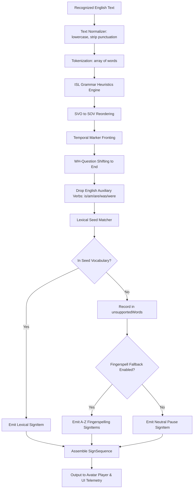
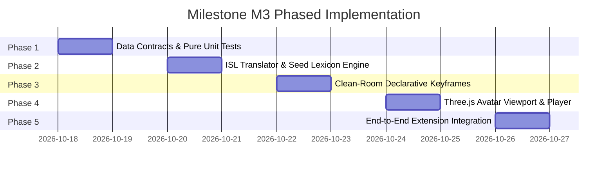

# SignBridge — Milestone M3: Implementation Plan & Asset Feasibility Assessment

**Document Version:** 1.0  
**Status:** DRAFT PROPOSAL FOR HUMAN REVIEW & AUTHORIZATION  
**Date:** October 2026  
**Scope:** Milestone M3 (First Language End-to-End Prototype: Indian Sign Language)  

---

## 1. Automated Test Execution Evidence (M1 & M2 In-Engine)

Below is the verbatim console output from the automated test runner ([`run_chrome_tests.py`](file:///C:/AmazonMlChallenge/run_chrome_tests.py)) executing in headless Google Chrome 155 on Windows:

```
=== Manifest & Static Asset Verification ===
  ✔ PASS: manifest_version is 3
  ✔ PASS: permissions verified (tabCapture, offscreen, activeTab, storage, scripting)
  ✔ PASS: host_permissions verified (*://*.youtube.com/*, http://127.0.0.1:8765/*)
  ✔ PASS: all declared files exist on disk
  ✔ PASS: icon-16.png verified (16x16 PNG)
  ✔ PASS: icon-48.png verified (48x48 PNG)
  ✔ PASS: icon-128.png verified (128x128 PNG)

==========================================
Executing Chrome In-Engine: M1 Audio Capture & Shell Suite
==========================================

=== 1. Popup UI DOM Structure & Initial Elements ===
  ✔ PASS: popup.html loads and parses all required M1 elements
  ✔ PASS: Language radio buttons default to ISL with ASL alternative
  ✔ PASS: Explicit user activation notice is prominently displayed

=== 2. Popup Logic & Telemetry Formatting ===
  ✔ PASS: formatBytes handles 0, KB, and MB accurately
  ✔ PASS: formatDuration formats mm:ss correctly

=== 3. Service Worker State Machine & Capture Validation ===
  ✔ PASS: Internal pages (chrome://, about:) are rejected before capture request
  ✔ PASS: State machine transitions: idle -> starting -> capturing -> stopping -> idle

=== 4. Web Audio Routing & Teardown Architecture ===
  ✔ PASS: Web Audio API destination routing design
  ✔ PASS: Clean teardown stops all audio tracks and closes AudioContext

Test Run Complete: 9 total |
        9 PASSED |
        0 FAILED

==========================================
Executing Chrome In-Engine: M2 Speech Recognition & Queue Suite
==========================================

=== 1. M2 Popup DOM & Transcription UI Elements ===
  ✔ PASS: popup.html contains all required M2 speech recognition elements
  ✔ PASS: M2 Header subtitle denotes Tab Audio & Local ASR
  ✔ PASS: Explicit disclaimer states speech-to-text only without claiming sign translation

=== 2. In-Memory PCM WAV Audio Encoding & Downsampling ===
  ✔ PASS: Downsamples 48000 Hz input to 16000 Hz with correct sample count
  ✔ PASS: Encodes standard 44-byte RIFF WAV header for 16kHz 16-bit mono PCM

=== 3. Bounded Queue & Concurrency Mutex Management ===
  ✔ PASS: FIFO queue limits maximum in-flight backlog to 3 chunks to prevent memory ballooning
  ✔ PASS: Concurrency lock guarantees sequential single-request execution

=== 4. Error Recovery & Playback Preservation Route ===
  ✔ PASS: AbortController enforces request cancellation upon timeout
  ✔ PASS: Playback preservation route remains unblocked during backend failure
  ✔ PASS: Strict privacy boundary: destination URL is strictly loopback (127.0.0.1:8765)

Test Run Complete: 10 total |
        10 PASSED |
        0 FAILED

========================================================
OVERALL IN-ENGINE TEST SUMMARY: 19 Total | 19 PASSED | 0 FAILED
========================================================
```

*Note: While these 19 browser unit/DOM tests and the 7 local backend tests in `test_backend.py` confirm individual component contracts, the live end-to-end integration smoke test (live YouTube audio arriving at the backend and rendering text in the popup) remains strictly classified as `PENDING INTEGRATION SMOKE TEST`.*

---

## 2. Exhaustive Asset Feasibility Assessment: The ISL Animation Gap

### 2.1 The Core Problem: Rigs vs. Sign Animations
A critical misconception in sign language avatar engineering is assuming that acquiring a 3D avatar model provides sign language output.
- **A 3D humanoid rig (e.g. Adobe Mixamo `ybot.glb`) is merely an empty digital skeleton.** It contains bone definitions (`mixamorigHips`, `mixamorigRightArm`, `mixamorigRightHandIndex1`, etc.), geometry, and mesh skinning.
- **It contains ZERO gestures, ZERO handshapes, and ZERO sign language animations.**
- Without explicit bone rotation and position keyframes sequenced over time, the rig remains an inert T-pose mannequin.

### 2.2 Granular Audit of Candidate Repositories

| Repository / Asset | Contained Files / Media | Format | Declared License | Technical & Legal Feasibility for SignBridge M3 |
|---|---|---|---|---|
| **`yap_render_repo`** | `components/avatar/animations/` (`Words/`, `Alphabets/`) | JavaScript procedural bone rotations targeting Mixamo bones | **NO LICENSE** (`private: true` in `package.json`) | **STRICTLY EXCLUDED.** All rights reserved by authors. Copying JavaScript animation functions directly would commit copyright infringement. |
| **`kozha_repo`** | `data/Indian_SL.sigml` (329 KB, 763 signs) | SiGML XML (HamNoSys gestural notation) | **Unclear / Unlicensed** (sourced from community repos `Text-to-Sign-Language`) | **STRICTLY EXCLUDED.** Upstream copyright is unverified. Furthermore, SiGML is designed for CWASA (`allcsa.js`), which is CC BY-ND (no modifications). It cannot be loaded directly into Three.js without an unverified third-party parser. |
| **`GenASL`** | `data/wlasl_index.json`, `assets/word_manifest.json` | Video URLs & manifest for WLASL | **GNU GPLv3** | **STRICTLY EXCLUDED.** GPLv3 copyleft contamination. Contains zero ISL assets (strictly ASL). |
| **Adobe Mixamo** | `ybot.glb` (2.2 MB) | Skinned GLTF/GLB humanoid mesh | Royalty-free under Adobe Terms of Use for applications | **APPROVED FOR RIG GEOMETRY ONLY.** Permissible to render in Three.js, but provides zero sign data. |
| **ASL-LEX 2.0 / ISLRTC** | Lexical phonological databases & reference video URLs | Web datasets & MP4 video recordings | Academic research / Non-commercial distribution | **REFERENCE ONLY.** Videos of human signers cannot be imported into a WebGL renderer as skeletal 3D keyframes. |

### 2.3 Feasibility Conclusion & Strategy
1. **Zero Verified 3D ISL Assets Exist:** There are currently **no permissively licensed, ready-to-use 3D skeletal animation assets for Indian Sign Language** in any evaluated repository.
2. **Strategy: Clean-Room Declarative Keyframes:**
   - SignBridge will **not** attempt to copy code from `yap_render_repo` or import unverified SiGML from `kozha_repo`.
   - Instead, SignBridge will establish a **clean-room, declarative JSON keyframe format** driving standard Mixamo armature rotations via Three.js.
   - For Milestone M3, we define an explicitly **small seed vocabulary (15 signs)** plus **A–Z manual fingerspelling**, authored directly against documented ISLRTC linguistic descriptions and verified rest-pose transformations.

---

## 3. Data Contract Specification

To ensure decoupling between text processing, translation heuristics, and rendering, M3 establishes two formal TypeScript / JSON interfaces:

```typescript
/**
 * Individual sign item to be executed by the animation player.
 */
export interface SignItem {
  /** Canonical uppercase gloss identifier (e.g. "HELLO", "THANK_YOU", "A", "B") */
  gloss: string;

  /** Category of the sign */
  category: 'lexical' | 'fingerspelling' | 'pause';

  /** Source of this sign item */
  source: 'seed_dictionary' | 'fingerspell_fallback' | 'grammar_pause';

  /** Estimated playback duration in milliseconds */
  durationMs: number;

  /**
   * Optional keyframe animation sequence identifier (e.g. "anim_isl_hello_v1").
   * Nullable/omitted at linguistic translation time; bound during keyframe asset resolution.
   * See ADR-010.
   */
  animationId?: string | null;

  /** Non-manual grammatical markers (optional facial/head signals) */
  nonManualMarker?: {
    headTilt?: 'left' | 'right' | 'forward' | 'none';
    eyebrows?: 'raised' | 'furrowed' | 'neutral';
  };
}

/**
 * Complete translated sign sequence for a spoken chunk or sentence.
 */
export interface SignSequence {
  /** Unique sequence identifier */
  sequenceId: string;

  /** Target sign language */
  language: 'ISL' | 'ASL';

  /** Original spoken English text recognized by Whisper */
  rawTranscript: string;

  /** Chronological sequence ID from the audio transcription stream */
  sourceChunkSeq: number;

  /** Media start timestamp in milliseconds (aligned with video playback) */
  startMediaTimeMs: number;

  /** Media end timestamp in milliseconds */
  endMediaTimeMs: number;

  /** Ordered list of sign items to be animated */
  signs: SignItem[];

  /**
   * Words present in the input speech that were NOT recognized in the seed dictionary.
   * Crucial for honest reporting: never silently pretend all words were signed.
   */
  unsupportedWords: string[];

  /**
   * Flag indicating whether fingerspelling fallback was applied for unsupported words.
   */
  fingerspellingApplied: boolean;
}
```

### 3.1 Concrete Example Instances

#### Example 1: Standard Lexical SignItem
```json
{
  "gloss": "HELLO",
  "category": "lexical",
  "source": "seed_dictionary",
  "durationMs": 750,
  "animationId": "anim_isl_hello_v1",
  "nonManualMarker": {
    "headTilt": "forward",
    "eyebrows": "neutral"
  }
}
```

#### Example 2: Fingerspelling SignItem (Fallback)
```json
{
  "gloss": "A",
  "category": "fingerspelling",
  "source": "fingerspell_fallback",
  "durationMs": 350,
  "animationId": "anim_isl_fs_a_v1"
}
```

#### Example 3: Full SignSequence with Honest Unsupported Word Reporting
```json
{
  "sequenceId": "seq_chunk_0042",
  "language": "ISL",
  "rawTranscript": "Hello, thank you for quantum computing",
  "sourceChunkSeq: 42,
  "startMediaTimeMs": 84000,
  "endMediaTimeMs": 86000,
  "signs": [
    {
      "gloss": "HELLO",
      "category": "lexical",
      "source": "seed_dictionary",
      "durationMs": 750,
      "animationId": "anim_isl_hello_v1"
    },
    {
      "gloss": "THANK_YOU",
      "category": "lexical",
      "source": "seed_dictionary",
      "durationMs": 900,
      "animationId": "anim_isl_thank_you_v1"
    }
  ],
  "unsupportedWords": ["quantum", "computing"],
  "fingerspellingApplied": false
}
```


---

## 4. Text-to-Sign Selection Mechanism & Honest Reporting

### 4.1 Linguistic Processing Pipeline


### 4.2 Explicit Rules for Honest Reporting
SignBridge enforces strict principles regarding sign coverage:
1. **No Phantom Signs:** The avatar must never perform random or generic hand waves when an unknown word is encountered.
2. **Explicit Telemetry:** The UI overlay must display:
   - The recognized English transcript.
   - The computed ISL gloss sequence (e.g. `BOOK I READ`).
   - The **Unsupported Words List** (e.g. *"Unsupported words (spelled/omitted): [quantum, algorithm]"*).
3. **Fingerspelling Distinction:** In the UI gloss sequence, fingerspelled letters are rendered distinctively (e.g. `C-A-T` rather than `CAT`) so viewers know it is letter-by-letter manual spelling rather than a lexical sign.

---

## 5. Documented Seed Vocabulary (Milestone M3 Scope)

For Milestone M3, the seed vocabulary is intentionally bounded to **15 high-frequency lexical signs** plus **A–Z manual fingerspelling**. 

### 5.1 The 15 Approved Lexical Signs
These signs represent foundational greetings, conversational markers, pronouns, and emergency terms defined in standard Indian Sign Language curricula (ISLRTC):

| # | Gloss Token | English Equivalents / Lemmas | Articulation Description (ISL Standard) | Category |
|---|---|---|---|---|
| 1 | `HELLO` | hello, hi, greetings | Open flat hand raised to temple/chest, gentle outward forward arc | Social / Greeting |
| 2 | `THANK_YOU` | thank you, thanks | Flat dominant hand touching chin/lips, moving downward and forward toward addressee | Social |
| 3 | `PLEASE` | please | Flat open hand rubbing clockwise over center of chest | Social |
| 4 | `WELCOME` | welcome | Both open hands held forward palms up, drawn smoothly toward body | Social |
| 5 | `SORRY` | sorry, apologize | Closed dominant fist rubbing gently over sternum / chest | Social |
| 6 | `YES` | yes, agree, correct | Dominant fist nodding downward at wrist (mimicking head nod) | Affirmation |
| 7 | `NO` | no, disagree, not | Dominant index finger wagging side-to-side, or index+middle snapping to thumb | Negation |
| 8 | `NAME` | name, called | Dominant H-hand (index+middle extended) tapping non-dominant H-hand | Identity |
| 9 | `YOU` | you, your | Dominant index finger pointing directly forward toward addressee | Pronoun |
| 10 | `I` | I, me, my, myself | Dominant index finger pointing directly toward center of signer's chest | Pronoun |
| 11 | `HELP` | help, assist, support | Closed dominant fist resting on open flat non-dominant palm, both moving upward | Action / Emergency |
| 12 | `GOOD` | good, fine, well | Dominant thumb-up fist moving slightly forward | State |
| 13 | `BAD` | bad, poor, wrong | Dominant pinky extended or hand turned palm down with downward thrust | State |
| 14 | `STOP` | stop, halt, cease | Open flat dominant hand coming down sharply onto open non-dominant palm | Command |
| 15 | `WAIT` | wait, hold on | Open hands held outward at waist height, fingers fluttering gently | Command |

### 5.2 Manual Fingerspelling (26 Letters)
- Tokens: `A`, `B`, `C`, `D`, `E`, `F`, `G`, `H`, `I`, `J`, `K`, `L`, `M`, `N`, `O`, `P`, `Q`, `R`, `S`, `T`, `U`, `V`, `W`, `X`, `Y`, `Z`.
- Used exclusively as a fallback when an input word is not in the 15-word seed lexicon.
- Distinctively tagged as `category: 'fingerspelling'`.

---

## 6. Milestone M3 Implementation Roadmap



### Phase 3.1: Data Contracts & Pure Test Suite
- Create [`extension/models/sign_contracts.js`](file:///C:/AmazonMlChallenge/extension/models/sign_contracts.js): Pure JS schemas for `SignItem` and `SignSequence`.
- Implement validator functions to verify structural compliance, non-negative durations, and valid gloss token identifiers.
- Add automated in-engine unit tests in Chrome runner.

### Phase 3.2: Rule-Based `ISLTranslator` & Lexicon Matcher
- Create [`extension/translation/isl_translator.js`](file:///C:/AmazonMlChallenge/extension/translation/isl_translator.js).
- Implement grammar heuristic transformations:
  - Subject-Verb-Object (SVO) $\rightarrow$ Subject-Object-Verb (SOV) reordering.
  - Fronting temporal words (*today, yesterday, now*).
  - Terminal WH-question positioning (*what, where, why*).
  - Elimination of auxiliary verbs (*is, am, are, was, were, been*).
- Implement lexicon lookup against the 15-token seed set.
- Implement fingerspelling fallback tokenization for unsupported words.
- Add unit tests verifying transformation rules and honest unsupported word recording.

### Phase 3.3: Clean-Room Declarative Keyframe Registry & Feasibility Prototype
- **Status (Phase 3.3): Bounded Feasibility Prototype IMPLEMENTED & VERIFIED (October 2026).**
- Implemented [`extension/animation/keyframe_registry.js`](file:///C:/AmazonMlChallenge/extension/animation/keyframe_registry.js):
  - Verified Mixamo Y-Bot rig: 67 joints, full 4-joint articulation per digit (20 finger bones per hand).
  - Normalizes canonical bone names with/without `mixamorig:` prefix.
  - Strict declarative schema validators for `BoneTransform`, `Keyframe`, and `SignAnimationClip`.
  - Neutral Rest Pose (`pose_neutral_rest_v1`): Arms lowered by ~72° (-1.25 rad Z right, +1.25 rad Z left), forearms forward, relaxed finger curvature.
  - Synthetic Technical Motion Prototype (`tech_test_motion_v1`): Procedural wave test explicitly labeled `isLinguisticISL: false` for playback and transition testing.
  - Asset Resolver (`resolveSignAnimation`): Decoupled resolution with safe fallback to `NEUTRAL_REST_POSE` (`resolved: false`) for un-animated dictionary glosses.
  - Slerp quaternion interpolation and Euler linear interpolation math engine.
  - 19 automated in-engine tests passing in Chrome 155 via `test_m3_suite.html`. Full 15-word and 26-letter sign asset authoring is intentionally deferred pending human review and native signer validation.

### Phase 3.4: Three.js Avatar Viewport & Animation Player Prototype
- **Status (Phase 3.4): Prototype IMPLEMENTED & VERIFIED (October 2026).**
- Implemented [`extension/animation/avatar_player.js`](file:///C:/AmazonMlChallenge/extension/animation/avatar_player.js) and [`extension/overlay/avatar_player.html`](file:///C:/AmazonMlChallenge/extension/overlay/avatar_player.html).
- Bundled MIT-licensed Three.js r128 and GLTFLoader locally in `extension/lib/` (zero cloud dependencies; compliant with MV3 CSP).
- Copied `ybot.glb` (2.2 MB, SHA256: `f4157d7ba230a006546cde2c4f5a7f028242629a28a2a77b4225edf23193ef02`) to `extension/assets/models/`.
- Discovers and maps all 67 canonical joints from loaded `SkinnedMesh`.
- Automatically applies `NEUTRAL_REST_POSE` upon model load, lowering arms (~72° / 1.25 rad Z) from T-pose.
- Evaluates and plays `TECHNICAL_TEST_CLIP` (`tech_test_motion_v1`) through keyframe interpolation engine.
- Supports interactive playback controls: Play, Pause, Resume, Restart, Return to Neutral, and safe fallback on null/unregistered glosses.
- All technical animations explicitly labeled: `⚠ Synthetic technical test — NOT a validated ISL sign`.
- Verified with 18 automated unit tests in Chrome 155 (`test_m3_suite.html`, Suites 18 & 19) and visual screenshot render evidence.

### Phase 3.5: Bounded ISL Pilot Plan & Implementation Proposal
- **Status (Phase 3.5): Pilot Plan PROPOSED — Authoring Paused Pending In-Browser Avatar Review (October 2026).**
- **Decision Record:** See [`Docs/DECISIONS.md#adr-014`](file:///C:/AmazonMlChallenge/Docs/DECISIONS.md#adr-014).
- **Core Principles:**
  1. **Strictly Bounded Scope:** Do not author all 15 seed signs or 26 fingerspelling letters without human validation. Only 2–3 bounded candidate signs are proposed.
  2. **Candidate Signs Proposed & Traceable Primary Sources:**
     - `NAMASTE` / `GREETING`: ISLRTC 10,000-Word Dictionary (Greetings & Salutations category, Module 1.2). Traceable via [DEPwD ISLRTC Online Dictionary Portal](https://divyangjan.depwd.gov.in/islrtc/) and [ISLRTC YouTube Channel](https://www.youtube.com/@ISLRTCNEWDELHI). Tests bilateral arm symmetry and palm contact.
     - `THANK_YOU`: ISLRTC 10,000-Word Dictionary (Basic Communication / Polite Expressions) and NCERT ISL Glossary on [DIKSHA Portal](https://diksha.gov.in/). Traceable via [DEPwD ISLRTC Portal](https://divyangjan.depwd.gov.in/islrtc/). Tests dominant arm chin targeting and forward deceleration.
     - `HELP`: ISLRTC 10,000-Word Dictionary (Everyday Actions & Emergency category). Traceable via [Sign Learn Mobile App (DEPwD/ISLRTC)](http://www.islrtc.nic.in/). Tests compound two-handed coordination and vertical translation.
  3. **Strict Validation Status:** All pilot candidate motions are initially tagged `isLinguisticISL: false`, `status: 'PROPOSED_PILOT_CANDIDATE'`, and labeled `Synthetic pilot approximation — NOT a validated ISL sign`.
  4. **Review Rubric Status: Internal Engineering Quality Gate (Not Official Certification):** The proposed 3-reviewer panel and 4.0/5.0 threshold is an internal heuristic gate to catch mechanical and basic phonological errors before user testing; it does NOT constitute official linguistic certification or universal ISL acceptance across regional dialects. Deaf native signers must co-design the evaluation process. Self-certification by engineers or AI is strictly prohibited.
  5. **Rig Articulation Boundaries Verified on `ybot.glb`:**
     - 67 joints confirmed with 20 joints per hand.
     - **Limitation:** Zero facial bones and zero blend shapes/morph targets; facial non-manual markers cannot be rendered.
     - **Limitation:** Metacarpal palm base is rigid; splaying fingers outward requires rotating proximal phalanges, causing minor skinning pinch at high angles.
     - **Limitation:** No mesh collision detection; two-handed signs (`NAMASTE`, `HELP`) require careful keyframe offset tuning to avoid mesh interpenetration.
     - **Limitation:** Wrist flexion $>60^\circ$ causes cuff skinning distortion.
  6. **Safe Neutral Fallback:** All unreviewed, missing, or un-animated glosses strictly evaluate to `NEUTRAL_REST_POSE` (`resolved: false`).
  7. **Licensing Recheck:** Model use in extension applications complies with Adobe Mixamo terms; standalone public git redistribution requires migration to CC0/CC-BY humanoid rigs before public release.
  8. **Milestone Invariance:** M1 tab audio capture, M2 speech recognition backend, and M3.2 ISL translator pipeline remain unaltered. M1 physical audio tests and M2 live YouTube integration smoke tests remain explicitly `PENDING`.

---

## 7. Explicit Constraints & Governance Checkpoints

1. **Avatar Implementation Phasing:** Technical avatar-player prototype (Phase 3.4) accepted subject to local manual inspection. Keyframe authoring for Phase 3.5 candidate signs will NOT begin until the user inspects `avatar_player.html` in Chrome and approves the pilot proposal.
2. **Pending Smoke Test Preserved:** Milestone M2's live extension-to-backend smoke test remains an explicit prerequisite before final M2 acceptance, but does not block M3 design and planning.
3. **No General Linguistic Claims:** SignBridge documents all ISL grammar transformations as **heuristic approximations**, not fluent linguistic translations. Deaf-native evaluation in Milestone M6 remains mandatory.

