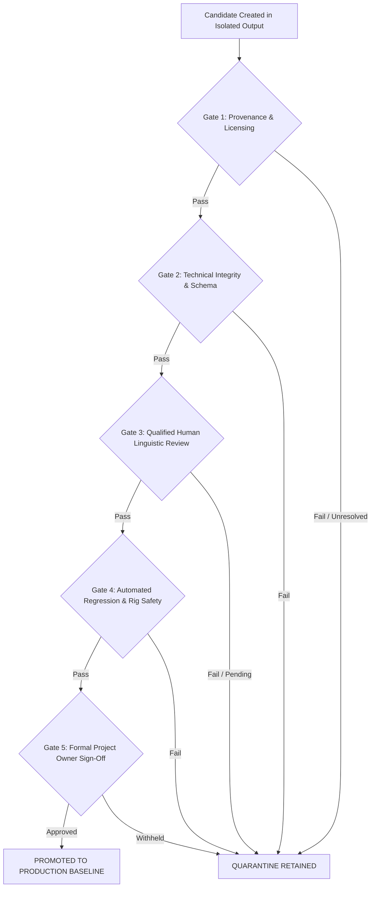

# SignBridge M4 — Stage 2: Animation Promotion Gates & Rollback Protocol

**Document Reference:** `Docs/M4_STAGE_2_PROMOTION_GATES.md`  
**Milestone:** SignBridge M4 Stage 2 (ISL Coverage Audit & Review Protocol)  
**Execution Date:** October 20, 2026  
**Status:** **`ACTIVE POLICY — ZERO CANDIDATES PROMOTED`**  
**Auditor / Implementation Agent:** Antigravity Autonomous Pair Programming Auditor  
**Governance State:** **`DRY_RUN_ONLY — NOT_AUTHORIZED — ZERO EXTERNAL OUTREACH`**  
**Active Production Baseline:** `isl_namaste_godl_v1` (Active & Protected)  
**Evaluated Motion Candidate:** `isl_namaste_mocap_candidate_v1` (Quarantined)  

---

## 1. Executive Purpose & Governance Boundary

This document establishes the mandatory verification gates that an experimental candidate animation asset must satisfy before it can transition from `EXPERIMENTAL_QUARANTINED` to `HUMAN_VALIDATED` production baseline status.

> [!CAUTION]
> **Zero Premature Promotion Rule:**
> No candidate animation (including `isl_namaste_mocap_candidate_v1`) may be promoted during Milestone M4 Stage 2. Candidates must remain quarantined until all five promotion gates are fully satisfied with verifiable, non-synthetic evidence and explicit project-owner approval.

---

## 2. The 5 Mandatory Promotion Gates

A candidate asset must satisfy every gate sequentially. Failure at any single gate results in immediate quarantine retention.



---

### Gate 1: Source Provenance & Licensing Clearance
- **Requirement:** Absolute legal certainty regarding source footage and derivative 3D skeletal animation rights.
- **Criteria:**
  1. Authoritative written confirmation or official government open data licensing terms (e.g., Government Open Data License - India / GODL) covering commercial and non-commercial derivative creation.
  2. **Unresolved Licensing Question:** The licensing status of the reference video (`ISLRTC_Namaste_sample.mp4`) remains unresolved. Rights cannot be inferred from third-party hosting mirrors (e.g., YouTube standard vs. Creative Commons markers).
  3. **Strict Redistribution Restriction:** The reference video must NOT be distributed externally, packaged into the Chrome extension bundle, or uploaded to public repositories.
- **Current Status for `isl_namaste_mocap_candidate_v1`:** **`BLOCKED (UNRESOLVED LICENSING)`**.

---

### Gate 2: Exact Cryptographic Identity & Schema Compliance
- **Requirement:** Immutable verification of asset identity and kinematic soundness.
- **Criteria:**
  1. File integrity matches expected cryptographic hash:
     - `candidateSha256`: `6f24e60f7f55d71482133790ca60f6a52682a38f7f6b32c8921480586cef4a46` (528,122 bytes).
  2. Full adherence to `SignAnimationClip` contract schema (`animationId`, `gloss`, `durationMs`, `keyframes`).
  3. Monotonically increasing keyframe time offsets (`timeMs`).
  4. All bone transforms match canonical 67-joint Mixamo Y-Bot skeleton without joint penetration or non-finite rotations.
- **Current Status for `isl_namaste_mocap_candidate_v1`:** **`PASSED`** (Verified in `test_review_readiness.py`).

---

### Gate 3: Genuine Qualified Human Linguistic Review
- **Requirement:** Attributable, reproducible endorsement by qualified native signers or certified interpreters.
- **Criteria:**
  1. Minimum **3 independent review records** from qualified evaluators (Category A Deaf-Native or Category B Certified DISLI/ISLRTC interpreter).
  2. **Acceptance Threshold:** At least **80% overall score** across the multi-parameter rubric (Handshape, Orientation, Movement, Location, NMM, Comprehensibility).
  3. Zero `UNACCEPTABLE` verdicts on core meaning.
  4. Review records must be stored in `tools/isl_motion_extraction/reviews/` and validate successfully via `validate_review_record.py`.
  5. Cryptographic hash in the review record must exactly match `candidateSha256`.
- **Current Status for `isl_namaste_mocap_candidate_v1`:** **`BLOCKED (HUMAN REVIEW PENDING — 0 REVIEWS RECORDED)`**.

---

### Gate 4: Automated Regression, Routing & Playback Safety
- **Requirement:** Seamless integration with zero pipeline disruptions or cross-language contamination.
- **Criteria:**
  1. Passes 100% of the M3 full regression suite (246 checks).
  2. Passes 100% of M4 Stage 1 & Stage 2 integration suites.
  3. Renders cleanly at 60 FPS in WebGL context on Mixamo Y-Bot without skinning artifacts or canvas culling errors.
  4. Returns cleanly to `NEUTRAL_REST_POSE` within 300ms of clip completion.
  5. Does NOT cross-route into ASL pipeline or replace other lexical entries.
- **Current Status for `isl_namaste_mocap_candidate_v1`:** **`PASSED (TESTED IN ISOLATED RUNNER)`**.

---

### Gate 5: Formal Project Owner Approval
- **Requirement:** Explicit human-in-the-loop owner sign-off.
- **Criteria:**
  1. Formal review of the completed evidence dossier by the Project Owner.
  2. Written authorization documented in an Owner Decision Package.
  3. Explicit instruction to update `KeyframeRegistry.js` and promote candidate.
- **Current Status for `isl_namaste_mocap_candidate_v1`:** **`BLOCKED (NOT REQUESTED — DRY RUN ONLY)`**.

---

## 3. Promotion Gate Summary for Current Assets

| Asset Identifier | Gate 1: Licensing | Gate 2: Schema & Hash | Gate 3: Human Review | Gate 4: Automated Safety | Gate 5: Owner Approval | Overall Promotion Verdict |
|:---|:---:|:---:|:---:|:---:|:---:|:---:|
| `isl_namaste_godl_v1` | **PASS** (GODL data.gov.in) | **PASS** (Built-in) | **PENDING** (0 Reviews) | **PASS** (276 Checks) | **PASS** (Active Baseline) | **`ACTIVE PRODUCTION BASELINE (UNVALIDATED)`** |
| `isl_namaste_mocap_candidate_v1` | **BLOCKED** (Unresolved) | **PASS** (`6f24e6...`) | **BLOCKED** (0 Reviews) | **PASS** (Isolated) | **BLOCKED** (Not Authorized) | **`QUARANTINED (BLOCKED ON GATES 1, 3, 5)`** |

---

## 4. Instant Rollback Protocol

If a promoted asset is found post-deployment to cause linguistic confusion, user complaints, or technical instability, the following instant rollback procedure is pre-authorized:

### Rollback Step-by-Step Procedure:
1. **Trigger Condition:** Any documented linguistic inaccuracy reported by native signers, severe rendering regression, or licensing dispute.
2. **Immediate Action (Under 60 seconds):**
   - Revert default lexical resolution in `keyframe_registry.js`:
     ```javascript
     // INSTANT ROLLBACK TO KNOWN SAFE BASELINE:
     REGISTERED_CLIPS.set('isl_namaste_godl_v1', ISL_NAMASTE_CLIP);
     ```
   - Re-quarantine candidate asset with `isLinguisticISL: false`.
3. **Cache & Worker Invalidation:**
   - Increment extension manifest patch version.
   - Force reload of service worker and avatar player instances.
4. **Post-Rollback Incident Audit:**
   - Log incident in `Docs/INCIDENT_LOG.md`.
   - Freeze candidate promotion until root cause analysis is approved by Project Owner.

---

## 5. Summary & Stage 2 Conclusion

All promotion gates are formally defined and programmatically locked.
Candidate `isl_namaste_mocap_candidate_v1` remains securely quarantined, and `isl_namaste_godl_v1` remains the protected production baseline.
