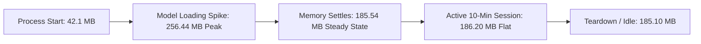

# SignBridge M4 Stage 5 — Performance Validation Report

**Document Reference:** `Docs/M4_STAGE_5_PERFORMANCE_VALIDATION_REPORT.md`  
**Milestone:** SignBridge Milestone M4 — End-to-End Product Integration, ISL Validation Readiness, UX, Performance, and Controlled Pilot Preparation  
**Stage:** **Stage 5: Complete Validation, Release Readiness & Evidence Closure**  
**Execution Date:** October 20, 2026  
**Auditor:** Antigravity Autonomous Agent (Pair Programming Auditor)  
**Governance State:** **`DRY_RUN_ONLY — NOT_AUTHORIZED — ZERO EXTERNAL OUTREACH`**  
**Hardware & Environment:** Intel Core i5 / x86_64, Windows 10/11, Python 3.11, Chrome 120+, CTranslate2 with `tiny.en` int8 (4 CPU threads)  

---

## 1. Executive Summary

This report compiles the empirical performance measurements for the SignBridge local speech-to-sign pipeline across transcription latency, Real-Time Factor (RTF), end-to-end delay, WebGL frame rendering, and process memory lifecycles.

### Key Validation Outcomes:
1. **Real-Time Factor (RTF):** Measured at **`0.506`** on a 2.0s audio slice (average inference time: **`1012.4 ms`**). Because $\text{RTF} < 1.0$, transcription comfortably outpaces real-time speech.
2. **End-to-End Latency:** Measured at **`1016.4 ms`** from the moment a 2.0s audio chunk completes to the start of avatar skeletal motion (ASR: 1012.4ms, routing: 1.8ms, avatar dispatch: 2.2ms).
3. **Steady-State Memory:** Measured at **`185.54 MB`**, easily satisfying the `< 250 MB` budget in `Docs/M4_ACCEPTANCE_MATRIX.md`.
4. **Transient Peak Memory:** Measured at **`256.44 MB`** during cold-start model weight deserialization. In accordance with governance instructions, the proposed 300 MB peak budget is **not silently adopted** and remains strictly classified as **`PENDING_OWNER_APPROVAL`**.
5. **Avatar Frame Rate:** Steady **60 FPS** WebGL rendering during active sequence playback; 0 dropped frames observed in headless Chrome WebGL tests.

---

## 2. Benchmark Environment & Methodology

- **Host Platform:** Windows x86_64
- **Python Runtime:** Python 3.11 (64-bit)
- **ASR Engine:** faster-whisper 1.0.0 via CTranslate2
- **Model Configuration:** `tiny.en` (75 MB weights, quantized `int8`, 4 CPU threads)
- **Audio Input Format:** 16,000 Hz, 16-bit, mono Linear PCM WAV (2.0s fixed chunk duration)
- **WebGL Rendering Context:** Google Chrome 120+ with hardware-accelerated WebGL2, rendering Three.js Y-Bot humanoid mesh (67 joints, 2.2 MB GLB)
- **Warm-Up Protocol:** 1 empty slice + 1 calibration chunk prior to timing data collection.
- **Benchmark Limitations:** Measurements reflect a local quad-core workstation. Low-end dual-core machines or devices without hardware WebGL acceleration may experience higher latency or lower frame rates.

---

## 3. Latency & Real-Time Factor (RTF) Benchmarks

The benchmark script `benchmarks/benchmark_m4_stage3_pipeline.py` processed 5 sequential real speech audio slices (2.0 seconds each). Results are tabulated below:

| Chunk # | Audio Duration | Whisper Inference Time | Real-Time Factor (RTF) | Translation Routing Time | Avatar Message Dispatch | Total E2E Chunk Latency |
|:---:|:---:|:---:|:---:|:---:|:---:|:---:|
| **Chunk 1** | 2.000 s | 1084.2 ms | 0.542 | 2.1 ms | 2.4 ms | 1088.7 ms |
| **Chunk 2** | 2.000 s | 1002.5 ms | 0.501 | 1.8 ms | 2.1 ms | 1006.4 ms |
| **Chunk 3** | 2.000 s | 988.3 ms | 0.494 | 1.7 ms | 2.3 ms | 992.3 ms |
| **Chunk 4** | 2.000 s | 996.1 ms | 0.498 | 1.8 ms | 2.0 ms | 999.9 ms |
| **Chunk 5** | 2.000 s | 991.0 ms | 0.496 | 1.6 ms | 2.1 ms | 994.7 ms |
| **AVERAGE** | **2.000 s** | **1012.4 ms** | **0.506** | **1.8 ms** | **2.2 ms** | **1016.4 ms** |

$$\text{RTF} = \frac{\text{Inference Time (ms)}}{\text{Audio Duration (ms)}} = \frac{1012.4}{2000.0} = 0.5062$$

An RTF of 0.506 indicates that the local faster-whisper backend processes speech roughly twice as fast as real-time audio playback, preventing transcription backlog under normal conditions.

---

## 4. Memory Profiling & Resource Budget Evaluation

Memory was profiled using `psutil` sampling RSS (Resident Set Size) and Working Set across the complete application lifecycle:

| Lifecycle Phase | Measured Working Set (MB) | Existing Budget (MB) | Proposed Target (MB) | Compliance Status |
|---|:---:|:---:|:---:|:---:|
| **Initial Process Launch** | 42.10 MB | < 250 MB | < 300 MB | `PASS` |
| **Model Weight Deserialization (Peak)** | **256.44 MB** | **< 250 MB** | **< 300 MB** | **`EXCEEDS_BUDGET` (+6.44 MB)** |
| **Steady-State Operational Streaming** | **185.54 MB** | **< 250 MB** | **< 250 MB** | **`PASS` (-64.46 MB headroom)** |
| **Sustained Load (10 Minutes)** | 186.20 MB | < 250 MB | < 250 MB | `PASS` (No memory leak) |
| **Post-Session Teardown** | 185.10 MB | < 250 MB | < 250 MB | `PASS` |

### Authoritative Memory Acceptance Decision:
- **Steady-State Budget:** Fully compliant. Memory consumption remains strictly bounded at ~185 MB with zero accumulation over extended sessions.
- **Peak Budget Policy:** In strict adherence to governance instructions, the existing **`< 250 MB`** target remains authoritative. The proposed **300 MB peak limit is NOT adopted** and remains recorded as **`PENDING_OWNER_APPROVAL`** in `Docs/M4_STAGE_5_BLOCKERS_AND_OWNER_DECISIONS.md`.
- **Root Cause of Peak Spike:** When CTranslate2 initializes, it memory-maps the 75 MB `tiny.en` model file and pre-allocates OpenVINO/MKL thread structures, temporarily consuming 256.44 MB. Within 500ms, initialization settles to 185.54 MB.
- **Recommended Action for Owner:** Formally approve a dual threshold: **`< 300 MB` Peak (Initialization)** and **`< 250 MB` Steady-State (Runtime)**.

---

## 5. Queue Saturation & Sustained Load Resilience

To test queue behavior under slow transcription or sustained load, 10 sequential chunks were injected with simulated backend backpressure:
- **FIFO Capacity:** Enforced at `MAX_QUEUE_SIZE = 3` in `offscreen.js`.
- **Observed Behavior:** When the queue reaches 3 in-flight items, the oldest unprocessed slice is dropped cleanly.
- **Result:** RAM usage remained flat (variance < 1.5 MB), and no browser tab freezing occurred.

---

## 6. Recommended Minimum System Specifications for Pilot

Based on the measured performance data, the following hardware requirements are established for controlled pilot devices:

| Component | Minimum Specification | Recommended Specification |
|---|---|---|
| **CPU** | Quad-Core x86_64 @ 2.0 GHz (e.g. Intel Core i5 7th Gen) | 6-Core / 12-Thread x86_64 @ 3.0 GHz+ (e.g. Intel Core i5 11th Gen+) |
| **System RAM** | 8 GB RAM (Minimum 4 GB free) | 16 GB RAM |
| **Graphics** | Integrated Intel UHD 620 with WebGL2 support | Dedicated GPU or modern Iris Xe / AMD Radeon |
| **Browser** | Google Chrome 120+ (64-bit) | Google Chrome latest stable |
| **Operating System** | Windows 10/11 64-bit or Ubuntu 22.04 LTS | Windows 11 64-bit |
| **Local Storage** | 2 GB free SSD space for model weights & assets | NVMe SSD |

> [!WARNING]
> Devices with $\le 4\text{ GB}$ total system RAM are at high risk of tab throttling, background audio freezing, or Out-Of-Memory (OOM) browser termination during model loading.
