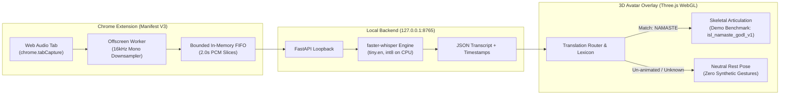

# SignBridge

A local-first browser extension prototype for real-time speech transcription and Indian Sign Language (ISL) 3D avatar visualization.

[](extension/manifest.json)
[](signbridge-backend/)
[](LICENSE)
[](Docs/DEMO_RUNBOOK.md)

---

## Overview

Deaf and Hard-of-Hearing viewers watching streaming web video often encounter content lacking sign language interpretation. Commercial cloud translation services typically require recurring per-minute API fees, introduce latency, and transmit user audio to external infrastructure.

**SignBridge** explores a local-first, privacy-conscious engineering alternative:

- **Direct Tab-Audio Capture:** Captures digital tab audio directly inside the browser using Chrome Manifest V3 APIs without room acoustics or physical microphone dependence.
- **Local Speech Recognition:** Slices audio in memory and transcribes it locally via a loopback service on `127.0.0.1:8765` using `faster-whisper` on CPU. During live session operation, audio and transcripts are processed in local memory without third-party cloud transcription APIs (initial setup requires standard package and model asset downloads).
- **Rule-Based Gloss Routing:** Maps recognized English words to Indian Sign Language (ISL) glosses using a strictly governed seed lexicon and zero-dependency data contracts.
- **3D Skeletal Animation:** Articulates verified sign language keyframes on a humanoid avatar using Three.js and WebGL.

---

## Prototype Scope & Linguistic Status

SignBridge is an experimental engineering prototype, not a complete or production-ready sign language translator.

- **Speech Recognition is Not Sign Language Translation:** Spoken English grammar does not map 1:1 to Indian Sign Language. Natural ISL possesses distinct syntactic structures (Subject-Object-Verb), spatial relationships, and non-manual markers (facial expressions and head tilts).
- **Current Sign Coverage:** The current lexicon defines 16 seed glosses. Exactly **one** user-facing demonstration benchmark is implemented: **`NAMASTE`** (1800 ms, a hand-authored gesture based on the ISLRTC baseline under the Government Open Data License - India). Formal linguistic validation remains pending (**0 of 3** certified Deaf-native reviews completed), and it must not be treated as an approved or production-ready ISL translation. The remaining 15 dictionary entries (`HELLO`, `THANK_YOU`, `PLEASE`, `SORRY`, etc.) resolve with `animationId: null` and safely hold a neutral rest pose pending verified source motion data.
- **Zero Fabricated Gestures:** When speech contains out-of-lexicon words or un-animated vocabulary, the avatar intentionally holds a neutral rest pose (`pose_neutral_rest_v1`). Fabricating synthetic gestures for unverified signs is strictly prohibited by project governance.
- **Quarantined Motion Capture:** A computer-vision derived candidate clip (`isl_namaste_mocap_candidate_v1.json`) exists in `tools/` and `extension/assets/animations/`, but remains quarantined due to flagged anomaly frames (22, 59, 62).
- **Safety Restriction:** SignBridge must never be used for safety-critical, medical, emergency, or legal communications.

For complete coverage audits and governance policies, see [Docs/KNOWN_LIMITATIONS.md](Docs/KNOWN_LIMITATIONS.md).

---

## Architecture & Data Flow



---

## Key Features

- **Microphone-Free Tab Capture:** Uses `chrome.tabCapture` to isolate pure digital tab audio. Continuous audio pass-through preserves normal sound output through system speakers.
- **Local Loopback Processing:** Runtime audio processing, transcription, and sign routing operate locally on localhost (`127.0.0.1:8765`). No third-party cloud speech APIs, paid subscriptions, or runtime audio telemetry are required.
- **Strict Data Contracts:** Sign items and sequences are deeply frozen and immutable (`SignBridgeContracts`), preventing mid-playback state corruption.
- **Transparent Status Telemetry:** Both the popup UI and the 3D player honestly surface pipeline states (`TRANSLATED`, `PARTIAL / UNSUPPORTED`, `UNSUPPORTED`) and list unsupported words explicitly.
- **Hardware-Accelerated WebGL Viewport:** Renders a 65-joint canonical humanoid skeletal rig via Three.js with timeline interpolation in a dockable browser overlay.
- **Review Studio Tooling:** Includes a synchronized side-by-side MoCap Review Studio (`tools/isl_motion_extraction/preview_mocap.html`) with frame scrubbers, anomaly jump buttons, and a standardized 5-parameter ISL evaluation rubric.

---

## Technology Stack

| Layer | Technologies |
| :--- | :--- |
| **Extension Frontend** | Chrome Manifest V3, Vanilla JavaScript (ES2022), Web Audio API (`AudioContext`, `ScriptProcessorNode`) |
| **3D Avatar Rendering** | Three.js (r128), WebGL2, Adobe Mixamo Y-Bot canonical humanoid skeletal rig |
| **ASR Backend** | Python 3.10+, FastAPI, Uvicorn, `faster-whisper` (CTranslate2, `tiny.en`, int8 CPU quantization) |
| **Data Contracts** | Zero-dependency UMD JavaScript (`SignItem`, `SignSequence`), strict schema validation |
| **Tooling & Extraction** | Google MediaPipe Tasks (Holistic Landmarker), 1-Euro adaptive temporal filter, bilateral wrist constraint solvers |

---

## Local Setup

### 1. Prerequisites
- **Operating System:** Windows 10/11 (x86_64, verified environment). macOS and Linux are untested / unverified environments.
- **Python:** 3.10 or 3.11 (tested on Python 3.10 on Windows)
- **Node.js:** 18+ (for running contract unit tests)
- **Browser:** Google Chrome 120+ with hardware acceleration enabled

### 2. Start the Local ASR Backend

```powershell
# Navigate to the backend directory
cd signbridge-backend

# Create and activate a virtual environment
python -m venv .venv
.venv\Scripts\Activate.ps1

# Install backend dependencies
pip install -r requirements.txt

# Start the local FastAPI service
python run.py
```

Verify backend health by opening `http://127.0.0.1:8765/health` or running:

```powershell
curl http://127.0.0.1:8765/health
```

Expected response: `{"status":"ok","service":"signbridge-backend","version":"0.2.0","model":"tiny.en",...}`

### 3. Load the Chrome Extension

1. Open Google Chrome and navigate to `chrome://extensions/`.
2. Enable **Developer mode** (top-right toggle).
3. Click **Load unpacked** and select the `extension/` directory.
4. Pin the SignBridge extension to the Chrome toolbar.

### 4. 3D Avatar Model Dependency

The 3D avatar viewport requires the Adobe Mixamo Y-Bot mesh (`ybot.glb`, ~2.24 MB). Under repository tracking rules (`models/` in `.gitignore`), binary model assets are excluded from Git to honor licensing boundaries and keep the repository lightweight.

For local execution on a fresh clone:
- Sourcing requirements and licensing terms are detailed in [Docs/ASSET_LICENSES.md](Docs/ASSET_LICENSES.md) (Section 2.2: Adobe Mixamo terms of use).
- The mesh file must be placed at:
  ```text
  extension/assets/models/ybot.glb
  ```
*(In the existing working environment, this file is already installed in `extension/assets/models/` and ignored by Git.)*

### 5. Run a Demonstration

Open the Avatar Player in Chrome:
```text
chrome-extension://<EXTENSION_ID>/overlay/avatar_player.html
```

Follow the step-by-step instructions in [Docs/DEMO_RUNBOOK.md](Docs/DEMO_RUNBOOK.md) to demonstrate:
- Speech recognition on live web audio
- The 1800 ms Namaste demonstration benchmark
- Safe neutral fallback for unsupported or un-animated vocabulary

---

## Verification & Testing

SignBridge includes automated test suites covering browser WebGL kinematics, contract immutability, and translation routing:

```powershell
# In-Engine Chrome WebGL Suite (132 checks)
python run_chrome_tests.py

# Data Contract Immutability Suite (37 checks)
node extension/tests/test_sign_contracts.js

# Live Speech Routing & Telemetry Regression Suite (65 checks)
python -m unittest tests/test_live_speech_routing_regression.py

# Sign Coverage & Review-Ready Workflow Suites (15 checks)
python -m unittest tests/test_m8_sign_coverage_regression.py tests/test_m8_1_review_ready_workflow.py
```

### Known Test Exceptions

- **Reference Video Absence (`LEGAL-01`):** Running `tools/isl_motion_extraction/check_review_readiness.py` (24/25 passing) or `tests/test_m4_stage5_validation.py` (16/18 passing) produces expected failures on `ISLRTC_Namaste_sample.mp4`. This file is intentionally omitted from the repository under an active legal hold pending copyright clearance.
- **Legacy Substring Check:** `test_m4_stage5_validation.py` contains a legacy static substring check from an earlier milestone that does not account for dynamic gloss interpolation in the updated player controller.

---

## Documentation Index

| Document | Description |
| :--- | :--- |
| [Docs/DEMO_RUNBOOK.md](Docs/DEMO_RUNBOOK.md) | Complete step-by-step operator manual for live demonstration and troubleshooting |
| [Docs/KNOWN_LIMITATIONS.md](Docs/KNOWN_LIMITATIONS.md) | Comprehensive register of vocabulary coverage, linguistic status, and licensing boundaries |
| [Docs/PRD.md](Docs/PRD.md) | Product Requirements Document and core architectural rules |
| [Docs/ARCHITECTURE.md](Docs/ARCHITECTURE.md) | System architecture design and component interactions |
| [Docs/ASSET_LICENSES.md](Docs/ASSET_LICENSES.md) | Exhaustive asset-by-asset provenance, copyright, and licensing audit |
| [Docs/COLLEGE_PROJECT_REPORT.md](Docs/COLLEGE_PROJECT_REPORT.md) | Academic report with evaluation rubric, ₹0 cost breakdown, and examiner setup |
| [Docs/M8_1_REVIEW_READY_SIGN_REGISTRY.md](Docs/M8_1_REVIEW_READY_SIGN_REGISTRY.md) | Sign provenance registry and review-ready vocabulary records |
| [Docs/M4_STAGE_2_HUMAN_REVIEW_PROTOCOL.md](Docs/M4_STAGE_2_HUMAN_REVIEW_PROTOCOL.md) | 5-parameter rubric for certified Deaf-native panel evaluations |

---

## Known Limitations & Governance

1. **Vocabulary Scale:** Only 1 demonstration benchmark (`NAMASTE`) is currently animated. Expanding to words such as `HELLO` and `THANK_YOU` is blocked pending open-licensed raw ISLRTC video footage.
2. **Linguistic Panel Clearance:** Formal Deaf-native review has not yet been conducted (**0 / 3 reviews completed**).
3. **Rig Facial Expressions:** The current Y-Bot humanoid mesh lacks facial blendshapes; non-manual markers (eyebrow raises, mouthings, head tilts) cannot be articulated.
4. **Third-Party Video Rights (`LEGAL-01`):** Raw reference videos crawled from third-party platforms remain under active legal hold.

---

## Roadmap

- **Institutional Co-Ownership:** Formalize outreach with Deaf-led organizations (e.g., ISLRTC, National Association of the Deaf) for collaborative evaluation.
- **Deaf-Native Human Review:** Conduct live evaluation sessions using the 5-parameter rubric in the MoCap Review Studio.
- **Rig Upgrade:** Retarget animations onto an expressive rig supporting facial blendshapes and non-manual markers.
- **Controlled Vocabulary Expansion:** Import verified open-data video datasets to safely expand from 1 to 20+ validated conversational signs.

---

## License

SignBridge contains components and assets governed by different licenses. See the terms and attribution requirements for each component below:

- **Application Code & Extension:** Licensed under the [MIT License](LICENSE).
- **Three.js Engine (`extension/lib/`):** The MIT License (Copyright © 2010-2026 three.js authors).
- **Namaste Motion Data (`isl_namaste_godl_v1`):** Derived from the official ISLRTC Indian Sign Language Dictionary (Vol. 1, Word #0001) via `data.gov.in` under the **Government Open Data License - India (GODL)**.
  *Mandatory Attribution:*
  > Source: Indian Sign Language Research and Training Centre (ISLRTC), via data.gov.in under GODL.
- **Adobe Mixamo Y-Bot Character Rig (`ybot.glb`):** Governed by Adobe General Terms of Use and Mixamo FAQ (royalty-free for interactive 3D character animation; raw character extraction and redistribution are restricted under Adobe terms).
- **MediaPipe Tasks Models:** Licensed under the Apache License 2.0 (Google LLC).

For the exhaustive granular provenance audit across all libraries, models, and corpora, see [Docs/ASSET_LICENSES.md](Docs/ASSET_LICENSES.md).

---

**Built by Lakshya Dogra and Smriti Verma**
