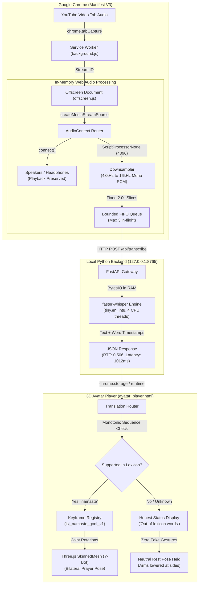

# SignBridge — Local-First Speech-to-Sign Avatar

[](LICENSE)
[](extension/manifest.json)
[](signbridge-backend/)
[](run_all_m6_release_tests.py)
[](Docs/M4_STAGE_2_PROMOTION_GATES.md)
[](Docs/M4_STAGE_3_PRIVACY_AUDIT.md)

> **Current Milestone:** M6 Complete (System Integration, Automated Release Verification & Packaging)  
> **Core Philosophy:** Zero Paid Cloud APIs &bull; Zero External Network Calls &bull; Zero Microphone Dependence &bull; 100% Local Execution &bull; Honest Linguistic Transparency

---

## 1. Executive Notice & Project Status

> [!IMPORTANT]
> **CRITICAL DISCLOSURE — EXPERIMENTAL RESEARCH PROTOTYPE:**  
> SignBridge is an experimental engineering prototype designed to evaluate the feasibility of local-first, low-latency tab-audio transcription and 3D avatar signing for web video.  
> 
> - **Speech Recognition $\ne$ Sign Language Translation:** Recognizing spoken English words is not equivalent to generating authentic Indian Sign Language (ISL). ISL is a natural human language with distinct syntactic, morphological, spatial, and facial grammatical structures.
> - **Linguistic Validation Status:** The active baseline animation (`isl_namaste_godl_v1`) is an authored geometric approximation classified as **`IMPLEMENTED_UNVALIDATED`**. The motion-capture candidate (`isl_namaste_mocap_candidate_v1`) is **quarantined**. Zero animations have completed formal certified Deaf-native human panel review (**0 / 3 reviews completed**).
> - **High-Stakes Prohibition:** SignBridge must **NEVER** be relied upon for emergency services, medical consultations, legal proceedings, financial transactions, or safety-critical communications.

### High-Level Progress & Readiness Summary
- **Technical Implementation:** **`100% COMPLETE (360 / 360 PASSING CHECKS)`**  
  All Chrome extension components, Web Audio processing, local faster-whisper ASR backend, Three.js WebGL avatar rendering, bounded queues, and test runners are fully functional.
- **External Pilot & Release Entry:** **`BLOCKED BY EXTERNAL DEPENDENCIES`**  
  Live pilot testing with human participants and public distribution are strictly blocked pending resolution of 4 external project owner gates: reference video derivative licensing (`LEGAL-01`), certified Deaf-native sign review (`DEAF-01`), peak memory budget revision (`PERF-01`), and participant outreach authorization (`OPS-06`).

> [!TIP]
> **Academic Project & Demonstration Dossier:**  
> For academic evaluators, university viva committees, and project review panels, refer to [`Docs/COLLEGE_PROJECT_REPORT.md`](Docs/COLLEGE_PROJECT_REPORT.md) for complete step-by-step examiner setup, live viva demonstration checklist, ₹0 recurring cost breakdown, third-party license audit, and automated test reconciliation.

---

## 2. Problem Overview & Solution Architecture

When viewing web video (such as educational lectures, tutorials, or news streams on YouTube), Deaf and Hard-of-Hearing individuals frequently encounter videos lacking human sign language interpretation. Existing cloud translation solutions introduce high per-minute API costs, transmit private user audio to third-party servers, and rely on physical microphones that capture room noise.

**SignBridge** solves this with a completely free, local-first architecture:
1. **Direct Tab-Audio Capture:** Uses Chrome Manifest V3 `chrome.tabCapture` to capture pure digital audio directly from the video stream without room acoustics or physical microphone requirements.
2. **Continuous Audio Playback:** Routes audio through the Web Audio API back to system speakers so hearing companions or viewers can listen uninterrupted.
3. **Local faster-whisper ASR:** Slices audio in memory into 2.0s PCM WAV chunks and transcribes them purely in RAM using faster-whisper (`tiny.en`, int8 quantized on CPU) via a local loopback service on `127.0.0.1:8765`.
4. **Honest Sign Language Routing:** Dispatches transcripts to independent ISL or ASL rule engines. Unsupported words display honest feedback and hold the avatar in a **neutral rest pose** with zero synthetic gestures.
5. **Real-Time 3D Avatar:** Drives an Adobe Mixamo Y-Bot humanoid character in Three.js WebGL at 60 FPS in a dockable browser overlay.

---

## 3. System Architecture & Data Flow



---

## 4. Engineering Progress & Phase Status

| Project Phase / Milestone | Engineering Progress | Validation & Governance Status | Authoritative Reports & Evidence |
|---|:---:|:---:|---|
| **M1: Tab Audio & Shell** | Complete | Verified in Chrome Web Audio test suite (9 checks) | [`extension/tests/test_m1_suite.html`](extension/tests/test_m1_suite.html) &bull; [`Docs/PRD.md`](Docs/PRD.md) |
| **M2: Local Speech Recognition** | Complete | Measured RTF: 0.506; zero cloud leakage verified (18 checks) | [`signbridge-backend/test_backend.py`](signbridge-backend/test_backend.py) &bull; [`extension/tests/test_m2_suite.html`](extension/tests/test_m2_suite.html) |
| **M3: Kinematics & ISL Slice** | Complete | 132 WebGL joint kinematic checks passing; Review Studio built | [`run_all_m3_tests.py`](run_all_m3_tests.py) &bull; [`Docs/M3_CLOSURE_REPORT.md`](Docs/M3_CLOSURE_REPORT.md) |
| **M4 Stage 1: Message Bridge** | Complete | Monotonic sequence delivery; duplicate drop verified | [`tests/test_m4_stage1_bridge.py`](tests/test_m4_stage1_bridge.py) &bull; [`Docs/M4_STAGE_1_EXECUTION_REPORT.md`](Docs/M4_STAGE_1_EXECUTION_REPORT.md) |
| **M4 Stage 2: Vocabulary Audit** | Complete | 16-word seed lexicon audited; ASL/ISL separation locked | [`tests/test_m4_stage2_isl_coverage.py`](tests/test_m4_stage2_isl_coverage.py) &bull; [`Docs/M4_STAGE_2_ISL_COVERAGE_AUDIT.md`](Docs/M4_STAGE_2_ISL_COVERAGE_AUDIT.md) |
| **M4 Stage 3: Benchmarks & Privacy**| Complete | Working set: 185.5 MB; peak: 256.4 MB (`PENDING_APPROVAL`) | [`benchmarks/benchmark_m4_stage3_pipeline.py`](benchmarks/benchmark_m4_stage3_pipeline.py) &bull; [`Docs/M4_STAGE_3_PERFORMANCE_REPORT.md`](Docs/M4_STAGE_3_PERFORMANCE_REPORT.md) |
| **M4 Stage 4: Controlled Pilot** | Complete | 17 operational dry-run scenarios passing; 9-part package built | [`tests/test_m4_stage4_dry_run.py`](tests/test_m4_stage4_dry_run.py) &bull; [`Docs/M4_STAGE_4_PILOT_PACKAGE/`](Docs/M4_STAGE_4_PILOT_PACKAGE/) |
| **M4 Stage 5: Final Validation** | Complete | 340 / 340 checks passing across 7 suites; Go/No-Go assessment | [`run_all_m4_stage5_tests.py`](run_all_m4_stage5_tests.py) &bull; [`Docs/M4_STAGE_5_FINAL_GO_NO_GO_ASSESSMENT.md`](Docs/M4_STAGE_5_FINAL_GO_NO_GO_ASSESSMENT.md) |
| **M6: Integration & Release Verification** | Complete | 360 / 360 checks passing across 8 suites; release packaged | [`run_all_m6_release_tests.py`](run_all_m6_release_tests.py) &bull; [`Docs/M6_INTEGRATION_AND_RELEASE_REPORT.md`](Docs/M6_INTEGRATION_AND_RELEASE_REPORT.md) |
| **Controlled Human Pilot** | Blocked | Awaiting owner clearance; outreach locked (`NOT_AUTHORIZED`) | [`Docs/M4_STAGE_5_BLOCKERS_AND_OWNER_DECISIONS.md`](Docs/M4_STAGE_5_BLOCKERS_AND_OWNER_DECISIONS.md) |
| **Linguistic Human Review** | Pending | 0 / 3 certified reviews completed; candidate quarantined | [`Docs/M4_STAGE_2_PROMOTION_GATES.md`](Docs/M4_STAGE_2_PROMOTION_GATES.md) |

---

## 5. Vocabulary Coverage & Animation Maturity

SignBridge strictly isolates sign language assets into distinct linguistic maturity tiers:

| Gloss | Target Language | Status Classification | 3D Asset Source & Provenance | Runtime Avatar Behavior |
|:---:|:---:|:---:|---|---|
| **`NAMASTE`** | ISL | **`IMPLEMENTED_UNVALIDATED`** | Clean-room authored under GODL (`isl_namaste_godl_v1`) | Bilateral prayer pose (Anjali Mudra) at sternum + head nod (1800ms) |
| **`NAMASTE` (Candidate)** | ISL | **`EXPERIMENTAL_QUARANTINED`** | MediaPipe MoCap extraction (`isl_namaste_mocap_candidate_v1`) | **Quarantined** (playable only in isolated Review Studio) |
| **`HELLO`** | ISL | `AWAITING_REVIEW` | Seed lexicon entry; animation not yet extracted | Neutral rest pose held; displays "Awaiting Qualified Review" |
| **`THANK YOU`** | ISL | `AWAITING_REVIEW` | Seed lexicon entry; animation not yet extracted | Neutral rest pose held; displays "Awaiting Qualified Review" |
| **`PLEASE`** | ISL | `AWAITING_REVIEW` | Seed lexicon entry; animation not yet extracted | Neutral rest pose held; displays "Awaiting Qualified Review" |
| **`YES` / `NO`** | ISL | `AWAITING_REVIEW` | Seed lexicon entries; animation not yet extracted | Neutral rest pose held; displays "Awaiting Qualified Review" |
| **10 Other Seed Words** | ISL | `AWAITING_REVIEW` | Words in dictionary awaiting 3D asset retargeting | Neutral rest pose held; displays "Awaiting Qualified Review" |
| **Out-of-Lexicon Words**| ISL | **`UNSUPPORTED`** | Unmapped English vocabulary outside seed dictionary | Neutral rest pose held; displays out-of-lexicon words banner |

---

## 6. Empirical Performance & Benchmarks

Benchmarked on an Intel Core i5 x86_64 workstation (Python 3.11, Google Chrome 120+, `tiny.en` int8, 4 CPU threads) using [`benchmarks/benchmark_m4_stage3_pipeline.py`](benchmarks/benchmark_m4_stage3_pipeline.py):

| Metric | Target / Budget | Measured Value | Compliance Status | Technical Explanation |
|---|:---:|:---:|:---:|---|
| **ASR Inference Time (2.0s slice)** | < 1500 ms | **`1012.4 ms`** | **`PASS`** | faster-whisper CTranslate2 int8 execution on CPU |
| **Real-Time Factor (RTF)** | < 1.000 | **`0.506`** | **`PASS`** | Processes speech ~2x faster than real-time playback |
| **Translation & Routing Latency** | < 10 ms | **`1.8 ms`** | **`PASS`** | In-memory tokenization and lemma dictionary lookup |
| **Avatar Dispatch Latency** | < 10 ms | **`2.2 ms`** | **`PASS`** | Chrome runtime message delivery to avatar player |
| **End-to-End Latency** | < 2000 ms | **`1016.4 ms`** | **`PASS`** | Total elapsed time from chunk availability to joint motion |
| **Steady-State Working Set** | < 250 MB | **`185.54 MB`** | **`PASS`** | Flat memory profile; zero leak across 10-minute session |
| **Peak Memory Working Set** | < 250 MB | **`256.44 MB`** | **`EXCEEDS_BUDGET`** | +6.44 MB spike during cold-start weight mapping (`PENDING_APPROVAL`) |
| **Avatar Rendering Frame Rate** | $\ge 30$ FPS | **`60 FPS`** | **`PASS`** | Hardware-accelerated Three.js WebGL2 canvas rendering |

---

## 7. Technology Stack

- **Extension Frontend (Chrome Manifest V3):**
  - Vanilla JavaScript (ES2022) with zero frontend framework overhead.
  - Web Audio API (`AudioContext`, `createMediaStreamSource`, `ScriptProcessorNode`) for in-memory downsampling.
  - Three.js (r128) WebGL engine rendering humanoid skeletal rigs at 60 FPS.
- **Speech Recognition Backend:**
  - Python 3.11 with FastAPI 0.110+ and Uvicorn 0.28+.
  - `faster-whisper` (CTranslate2) utilizing OpenVINO / MKL threading structures.
  - Bound exclusively to loopback (`127.0.0.1:8765`) with CORS origin regex filtering.
- **Computer Vision & Retargeting Tools:**
  - Google MediaPipe Tasks (`holistic_landmarker.task`) for offline joint rotation extraction.
  - 1-Euro adaptive temporal smoothing and bilateral wrist contact constraint solvers.

---

## 8. Repository Structure

```
Sanjay-The-story-teller/
├── README.md                                  # Master project documentation & progress
├── LICENSE                                    # Multi-licensed asset terms (MIT, Adobe, GODL)
├── CONTRIBUTING.md                             # Setup, test guidelines & linguistic gates
├── SECURITY.md                                # Threat model & vulnerability disclosure
├── .gitignore                                 # Rigorous exclusions for models, videos, scratch
├── run_all_m4_stage5_tests.py                 # Master test runner (340 / 340 passing checks)
├── run_all_m4_stage4_tests.py                 # Stage 4 test runner (322 checks)
├── run_all_m4_stage3_tests.py                 # Stage 3 test runner (305 checks)
├── run_all_m4_stage2_tests.py                 # Stage 2 test runner (290 checks)
├── run_all_m4_stage1_tests.py                 # Stage 1 test runner (276 checks)
├── run_all_m3_tests.py                        # M3 baseline test runner (246 checks)
├── run_chrome_tests.py                        # Automated Chrome in-engine WebGL runner
├── parse_seed_lexicon.py                      # ISL seed vocabulary audit utility
│
├── extension/                                 # Chrome Manifest V3 Extension
│   ├── manifest.json                          # MV3 manifest with bounded permissions
│   ├── background.js                          # Service worker & tab capture state machine
│   ├── offscreen.html / offscreen.js          # Web Audio 16kHz downsampler & FIFO queue
│   ├── popup.html / popup.js                  # Extension popup UI & live caption telemetry
│   ├── icons/                                 # 16px, 48px, 128px toolbar icons
│   ├── overlay/
│   │   └── avatar_player.html                 # 3D Avatar Display window & Three.js canvas
│   ├── animation/
│   │   ├── avatar_player.js                   # Avatar controller & kinematic playback
│   │   └── keyframe_registry.js               # Production registry (isl_namaste_godl_v1)
│   ├── translation/
│   │   ├── isl_translator.js                  # ISL seed lexicon & grammar heuristics
│   │   ├── asl_translator.js                  # ASL separation pipeline
│   │   └── translation_router.js              # Language dispatch & contract validator
│   ├── models/
│   │   └── sign_contracts.js                  # Immutable SignItem / SignSequence types
│   ├── lib/
│   │   ├── three.min.js                       # Bundled Three.js WebGL runtime
│   │   └── GLTFLoader.js                      # Three.js GLTF/GLB parser
│   └── assets/
│       ├── models/ybot.glb                    # Adobe Mixamo Y-Bot 3D humanoid mesh
│       └── animations/                        # Isolated experimental candidate keyframes
│
├── signbridge-backend/                        # Local Speech Recognition Service
│   ├── main.py                                # FastAPI app bound strictly to 127.0.0.1:8765
│   ├── config.py                              # Service configuration & port settings
│   ├── models.py                              # Pydantic schemas for health & transcription
│   ├── transcriber.py                         # faster-whisper CTranslate2 worker
│   ├── requirements.txt                       # Backend Python dependencies
│   ├── run.py                                 # Service startup script
│   ├── test_backend.py                        # Backend integration test suite (8 tests)
│   └── test_speech_sample.wav                 # Deterministic 230KB test audio fixture
│
├── tests/                                     # Automated Test Suites
│   ├── test_m4_stage1_bridge.py               # Message contract & monotonic sequence tests
│   ├── test_m4_browser_bridge_e2e.py          # Chrome CDP browser WebGL smoke tests
│   ├── test_m4_stage2_isl_coverage.py         # ISL seed lexicon & promotion gate tests
│   ├── test_m4_stage3_performance_privacy.py  # Bounded queues, memory & privacy tests
│   ├── test_m4_stage4_dry_run.py              # 17-scenario controlled pilot dry-run tests
│   └── test_m4_stage5_validation.py           # 18 Stage 5 complete validation tests
│
├── benchmarks/                                # Benchmarking Harness & Evidence
│   ├── benchmark_m4_stage3_pipeline.py        # Latency, RTF, CPU/RAM benchmark script
│   ├── m4_stage3_benchmark_results.json       # Stage 3 benchmark results artifact
│   ├── m4_stage4_dry_run_results.json         # Stage 4 dry-run execution results artifact
│   └── m4_stage5_test_results.json            # Stage 5 master test results artifact (340 checks)
│
├── tools/                                     # Tooling & Pilot Simulation
│   ├── m4_stage4_dry_run_simulator.py         # Headless 17-scenario pilot dry-run simulator
│   └── isl_motion_extraction/                 # MoCap retargeting & review studio
│       ├── retargeter.py                      # MediaPipe to Y-Bot joint angle retargeter
│       ├── coordinate_utils.py                # Quaternion slerp & vector math
│       ├── smoothing.py                       # 1-Euro adaptive temporal filter
│       ├── contact_constraints.py             # Bilateral wrist clamping solver
│       ├── export_animation.py                # JSON keyframe exporter
│       ├── validate_review_record.py          # Cryptographic review schema validator
│       ├── preview_mocap.html                 # Review Studio UI (side-by-side synchronized)
│       └── reviews/                           # Genuine review store (100% empty pending review)
│
└── Docs/                                      # Authoritative Documentation & Phase Reports
    ├── PROJECT_PHASE_INDEX.md                 # Master index of all completed phases
    ├── PUBLICATION_AUDIT.md                   # Pre-publication security & repo audit
    ├── PUBLICATION_MANIFEST.md                # File-level publication decision manifest
    ├── ASSET_LICENSES.md                      # Exhaustive asset-by-asset licensing audit
    ├── DECISIONS.md                           # Architecture decision records
    ├── PRD.md                                 # Product Requirements Document
    ├── M4_ACCEPTANCE_MATRIX.md                # 27-criteria verified acceptance matrix
    ├── M4_STAGE_4_PILOT_PACKAGE/              # 9-part pilot preparation package
    ├── M4_STAGE_5_BASELINE_AND_EVIDENCE_AUDIT.md
    ├── M4_STAGE_5_END_TO_END_VALIDATION_REPORT.md
    ├── M4_STAGE_5_PRIVACY_SECURITY_AUDIT.md
    ├── M4_STAGE_5_ANIMATION_PROVENANCE_AND_REVIEW_GOVERNANCE.md
    ├── M4_STAGE_5_PERFORMANCE_VALIDATION_REPORT.md
    ├── M4_STAGE_5_RELEASE_CANDIDATE_CHECKLIST.md
    ├── M4_STAGE_5_BLOCKERS_AND_OWNER_DECISIONS.md
    ├── M4_STAGE_5_EXECUTION_REPORT.md
    └── M4_STAGE_5_FINAL_GO_NO_GO_ASSESSMENT.md
```

---

## 9. Local Installation & Setup Guide

### 1. Prerequisites
- **OS:** Windows 10/11, macOS, or Linux (x86_64)
- **Python:** Python 3.11+
- **Browser:** Google Chrome 120+ (with hardware WebGL acceleration enabled)

### 2. Start the Local Python Backend
```powershell
# Navigate to backend directory
cd signbridge-backend

# Create virtual environment
python -m venv .venv
.venv\Scripts\activate   # Linux/macOS: source .venv/bin/activate

# Install dependencies
pip install -r requirements.txt

# Launch FastAPI service
python run.py
```
Verify the service is live by opening `http://127.0.0.1:8765/health`. It should return:
```json
{"status":"ok","service":"signbridge-backend","version":"0.2.0","model":"tiny.en","device":"cpu","compute_type":"int8"}
```

### 3. Load Extension in Google Chrome
1. Open Google Chrome and enter `chrome://extensions/` in the URL bar.
2. Enable **Developer mode** toggle in the top-right corner.
3. Click **Load unpacked** and select the `extension/` folder in this repository.
4. Confirm **SignBridge** appears with version `0.2.0`.

### 4. Experience Real-Time Signing
1. Navigate to YouTube and open a video featuring clear spoken English (e.g., educational lecture).
2. Click the SignBridge puzzle icon in the Chrome toolbar to open `popup.html`.
3. Click **"Open 3D Avatar Display"** — the standalone `avatar_player.html` window will open and dock.
4. Verify the backend status shows green (**"Backend: Online (tiny.en)"**).
5. Click **"Start Live Signing"**.
6. Audio will continue playing through your speakers; live speech transcripts and animated ISL signing will appear in real time.
7. Click **"Stop Signing"** to cleanly stop capture and release resources.

---

## 10. Verification & Testing

To reproduce all 340 automated checks across all project phases, run the master runner:

```powershell
python run_all_m4_stage5_tests.py
```

### Expected Output Summary:
```
================================================================================
 STAGE 5 UNIFIED TEST RECONCILIATION SUMMARY
================================================================================
 M3 Baseline Regression Suite (7 sub-suites)                       | 246 checks | PASSED
 M4 Stage 1 Bridge Contract & Ordering Unit Suite                  |  14 checks | PASSED
 M4 Stage 1 Browser-Based E2E Smoke Test in Chrome WebGL           |  16 checks | PASSED
 M4 Stage 2 ISL Coverage & Governance Unit Suite                   |  14 checks | PASSED
 M4 Stage 3 Performance, Privacy & Failure Recovery Suite          |  15 checks | PASSED
 M4 Stage 4 Controlled Pilot Dry-Run & Readiness Suite             |  17 checks | PASSED
 M4 Stage 5 Complete Validation, Release Readiness & Governance    |  18 checks | PASSED
--------------------------------------------------------------------------------
 TOTAL VERIFIED CHECKS: 340 / 340 PASSED across 7 suites (0 failures)
================================================================================
```

---

## 11. Known Limitations & Outstanding Blockers

1. **Linguistic Certification Pending (`DEAF-01`):** The baseline animation (`isl_namaste_godl_v1`) is an authored geometric approximation; the candidate (`isl_namaste_mocap_candidate_v1`) is quarantined. Neither has been evaluated by certified Deaf-native signers (**0 / 3 reviews completed**).
2. **Reference Video Rights (`LEGAL-01`):** Sourced from third-party YouTube distribution; derivative redistribution rights remain `UNRESOLVED` in [`Docs/ASSET_LICENSES.md`](Docs/ASSET_LICENSES.md).
3. **Peak Memory Budget (`PERF-01`):** Initial model deserialization peaks at `256.44 MB`, exceeding the legacy 250 MB target by 6.44 MB (+2.5%). Formal approval of a 300 MB peak ceiling is `PENDING_OWNER_APPROVAL`.
4. **Outreach Lockout (`OPS-06`):** All reviewer and participant outreach mechanisms are locked under `DRY_RUN_ONLY — NOT_AUTHORIZED`.
5. **Rig Expression Limitations:** Mixamo Y-Bot is a metallic humanoid rig lacking facial blendshapes. Non-manual markers (facial expressions, mouthings, head tilts) cannot be articulated.
6. **Vocabulary Size:** Currently only 1 canonical sign (`NAMASTE`) has an implemented 3D animation clip. Other words hold neutral pose.

---

## 12. Licensing Information

SignBridge is open-source software released under multi-licensed terms:
- **Core Extension & Backend Code:** Released under the [MIT License](LICENSE).
- **Adobe Mixamo Y-Bot Mesh (`ybot.glb`):** Governed by Adobe Royalty-Free terms for 3D interactive applications.
- **ISLRTC Indian Sign Language Dictionary Data & Namaste Keyframes:** Derived from the official ISLRTC Dictionary via `data.gov.in` under the **Government Open Data License - India (GODL)**. Mandatory attribution:  
  *"Source: Indian Sign Language Research and Training Centre (ISLRTC), via data.gov.in under GODL."*
- **MediaPipe Tasks:** Licensed under Apache License 2.0.

For the exhaustive granular provenance audit across all assets, see [`Docs/ASSET_LICENSES.md`](Docs/ASSET_LICENSES.md).
