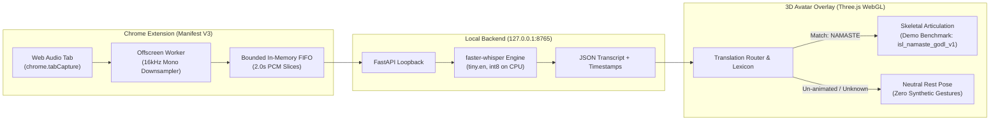

# SignBridge
## Speech-to-ISL Avatar Prototype

[](extension/manifest.json)
[](signbridge-backend/)
[](LICENSE)
[](Docs/DEMO_RUNBOOK.md)

SignBridge is an experimental, local-first browser extension prototype exploring real-time web video audio capture, offline speech recognition, rule-based Indian Sign Language (ISL) gloss mapping, and 3D humanoid avatar articulation.

---

## IMPORTANT // PROTOTYPE STATUS

> [!IMPORTANT]
> **EXPERIMENTAL RESEARCH PROTOTYPE — LINGUISTIC & SAFETY DISCLOSURE**
>
> - **Working Prototype, Not a Production Translator:** SignBridge is an engineering demonstration of local audio capture, speech transcription, and skeletal retargeting. It does not provide full natural language translation into Indian Sign Language.
> - **Spoken English $\ne$ Indian Sign Language:** English and ISL possess fundamentally different grammars. ISL uses Topic-Comment and Subject-Object-Verb (SOV) structure, spatial syntax, and facial non-manual expressions. Spoken words do not map word-for-word to sign gestures.
> - **Demonstration Benchmark Only:** Exactly **one** gesture has an implemented 3D animation clip: **`NAMASTE`** (1800 ms, derived from the ISLRTC baseline under GODL). All other dictionary entries (`HELLO`, `THANK_YOU`, etc.) resolve without animation and safely hold a neutral rest pose pending verified source motion data.
> - **Linguistic Validation Pending:** Formal Deaf-native review has not yet been conducted (**0 of 3** reviews completed). The Namaste demonstration clip remains classified as `experimental_awaiting_validation`.
> - **Quarantined Motion Capture:** A computer-vision derived candidate clip (`isl_namaste_mocap_candidate_v1.json`) is quarantined in `tools/` and excluded from production due to flagged kinematic anomalies (frames 22, 59, 62).
> - **Safety-Critical Prohibition:** SignBridge must **NEVER** be used for medical, legal, emergency, financial, or safety-critical communication.

For complete coverage audits and governance policies, see [Docs/KNOWN_LIMITATIONS.md](Docs/KNOWN_LIMITATIONS.md).

---

## DEMO PIPELINE // SIGNBRIDGE IN ACTION

> **OPERATING PIPELINE**: `TAB AUDIO` → `LOCAL TRANSCRIPTION` → `GLOSS ROUTING` → `AVATAR / NEUTRAL FALLBACK`



| Pipeline Stage | Implementation & Technical Behavior |
| :--- | :--- |
| **1. Digital Tab Capture** | Captures clean digital tab audio via Chrome Manifest V3 `chrome.tabCapture`. Audio pass-through preserves normal sound output through system speakers without microphone room acoustics. |
| **2. Local Speech Recognition** | Web Audio API downsamples stream to 16kHz mono PCM in memory; local FastAPI backend (`127.0.0.1:8765`) transcribes audio chunks using `faster-whisper` (`tiny.en`, int8 CPU). |
| **3. Rule-Based Gloss Routing** | Dispatches transcripts to independent language translation contracts. Evaluates recognized tokens against a 16-word seed lexicon with strict immutability guarantees. |
| **4. Skeletal Articulation** | Known baseline glosses (`NAMASTE`) trigger quaternion keyframe evaluation across 65 canonical humanoid joints in Three.js WebGL. |
| **5. Ethical Neutral Fallback** | Un-animated dictionary words (`HELLO`, `THANK_YOU`) and out-of-lexicon phrases strictly hold a neutral rest pose (`pose_neutral_rest_v1`). Zero synthetic gestures are fabricated. |

---

## CORE CAPABILITIES

- **Microphone-Free Tab Capture:** Uses `chrome.tabCapture` and Web Audio routing to capture streaming video audio directly, keeping speaker output audible and eliminating background room noise.
- **Local Loopback Processing:** Runtime audio capture, transcription, and gloss routing operate locally on localhost (`127.0.0.1:8765`). No third-party cloud speech APIs, paid subscriptions, or runtime audio telemetry are required.
- **Deeply Frozen Data Contracts:** Sign items and sequences are immutable (`SignBridgeContracts`), preventing mid-playback state corruption or race conditions.
- **Transparent Status Telemetry:** Both the extension popup and the 3D player honestly surface pipeline states (`TRANSLATED`, `PARTIAL / UNSUPPORTED`, `UNSUPPORTED`) and list unsupported words explicitly.
- **Hardware-Accelerated WebGL Viewport:** Renders a 65-joint canonical humanoid skeletal rig via Three.js with timeline interpolation in a dockable browser overlay.
- **Side-by-Side Review Studio:** Includes a dedicated MoCap Review Studio (`tools/isl_motion_extraction/preview_mocap.html`) with frame scrubbers, anomaly jump buttons, and a standardized 5-parameter ISL evaluation rubric.

---

## ARCHITECTURE & TECHNOLOGY

| Architectural Layer | Technologies & Runtime Role |
| :--- | :--- |
| **Extension Frontend** | Chrome Manifest V3, Vanilla JavaScript (ES2022), Web Audio API (`AudioContext`, `ScriptProcessorNode`) |
| **3D Avatar Viewport** | Three.js (r128), WebGL2, Adobe Mixamo Y-Bot canonical humanoid skeletal rig (65 joints) |
| **ASR Inference Backend** | Python 3.10+, FastAPI, Uvicorn, `faster-whisper` (CTranslate2, `tiny.en`, int8 CPU quantization) bound strictly to `127.0.0.1:8765` |
| **Data Contracts** | Zero-dependency UMD JavaScript (`SignItem`, `SignSequence`), strict schema validation and deep freeze |
| **Tooling & Extraction** | Google MediaPipe Tasks (Holistic Landmarker), 1-Euro adaptive temporal filter, bilateral wrist constraint solvers |

---

## LOCAL SETUP // RUN THE DEMO

### 1. Prerequisites
- **Operating System:** Windows 10/11 (x86_64, verified environment). macOS and Linux are untested / unverified.
- **Python:** 3.10 or 3.11 (tested on Python 3.10 on Windows)
- **Node.js:** 18+ (for running contract unit tests)
- **Browser:** Google Chrome 120+ with hardware WebGL acceleration enabled

### 2. Start the Local ASR Backend

```powershell
# Navigate to the backend directory
cd signbridge-backend

# Create and activate a virtual environment
python -m venv .venv
.venv\Scripts\Activate.ps1

# Install backend dependencies
pip install -r requirements.txt

# Start the local FastAPI service
python run.py
```

Verify backend health by opening `http://127.0.0.1:8765/health` or running:

```powershell
curl http://127.0.0.1:8765/health
```

Expected response: `{"status":"ok","service":"signbridge-backend","version":"0.2.0","model":"tiny.en",...}`

### 3. Load the Chrome Extension

1. Open Google Chrome and navigate to `chrome://extensions/`.
2. Enable **Developer mode** (top-right toggle).
3. Click **Load unpacked** and select the `extension/` directory.
4. Pin the SignBridge extension to the Chrome toolbar.

### 4. 3D Avatar Model Dependency

> [!IMPORTANT]
> **LOCAL ASSET REQUIREMENT: ADOBE MIXAMO Y-BOT (`ybot.glb`)**
> Under repository tracking rules (`models/` in `.gitignore`), binary 3D model meshes are excluded from Git to honor licensing boundaries and keep the repository lightweight.
>
> For local execution on a fresh clone:
> - Review licensing terms and Adobe Mixamo usage conditions in [Docs/ASSET_LICENSES.md](Docs/ASSET_LICENSES.md) (Section 2.2).
> - Place the Y-Bot character mesh file at:
>   ```text
>   extension/assets/models/ybot.glb
>   ```
> *(In the existing workspace, this asset is already installed and verified.)*

### 5. Run a Demonstration

Open the Avatar Player in Chrome:
```text
chrome-extension://<EXTENSION_ID>/overlay/avatar_player.html
```

Follow the step-by-step instructions in [Docs/DEMO_RUNBOOK.md](Docs/DEMO_RUNBOOK.md) to demonstrate:
- Speech recognition on live web audio
- The 1800 ms Namaste demonstration benchmark
- Safe neutral fallback for unsupported or un-animated vocabulary

---

## VERIFICATION // TEST RESULTS

SignBridge includes automated test suites covering browser WebGL kinematics, contract immutability, and translation routing:

```powershell
# In-Engine Chrome WebGL Suite (132 checks)
python run_chrome_tests.py

# Data Contract Immutability Suite (37 checks)
node extension/tests/test_sign_contracts.js

# Live Speech Routing & Telemetry Regression Suite (65 checks)
python -m unittest tests/test_live_speech_routing_regression.py

# Sign Coverage & Review-Ready Workflow Suites (15 checks)
python -m unittest tests/test_m8_sign_coverage_regression.py tests/test_m8_1_review_ready_workflow.py
```

### Known Test Exceptions

> [!WARNING]
> **DOCUMENTED TEST EXCEPTIONS**
>
> - **Reference Video Absence (`LEGAL-01`):** Running `tools/isl_motion_extraction/check_review_readiness.py` (24/25 passing) or `tests/test_m4_stage5_validation.py` (16/18 passing) produces expected failures on `ISLRTC_Namaste_sample.mp4`. This reference video is intentionally omitted from the repository under an active legal hold pending copyright redistribution clearance.
> - **Legacy Substring Check:** `test_m4_stage5_validation.py` contains a legacy static substring check in `test_09` from an earlier milestone that does not account for dynamic gloss interpolation in the updated player controller.

---

## KNOWN LIMITATIONS & LICENSING

### Implemented Capabilities (Working in Prototype)
- **Direct Tab Capture & Local ASR:** Captures clean streaming tab audio via `chrome.tabCapture` and executes local transcription on CPU via `faster-whisper` (`tiny.en`) at `127.0.0.1:8765`.
- **Lexicon & Contract Routing:** Implements a 16-word seed lexicon with deeply frozen, immutable JavaScript data contracts.
- **Single Benchmark Animation (`NAMASTE`):** Exactly 1 demonstration sign is animated (**`NAMASTE`**, 1800 ms keyframed articulation across 65 canonical humanoid joints).
- **Ethical Neutral Fallback:** Strictly preserves a neutral rest pose (`pose_neutral_rest_v1`) whenever un-animated or unrecognized words occur; zero synthetic gestures are fabricated.
- **Local Review Studio:** Provides a synchronized frame-by-frame MoCap Review Studio with kinematic anomaly scrubbers and an evaluation rubric.

### Planned & Blocked (Dependent on Future Data & Review)
- **Vocabulary Expansion:** Animating remaining seed words (`HELLO`, `THANK_YOU`, etc.) is **blocked** pending verified, open-licensed raw ISLRTC reference video datasets (`BLOCKED_SOURCE_OR_REVIEW`).
- **Linguistic Validation:** Formal Deaf-native review remains **pending** (**0 of 3** panel reviews completed). The Namaste benchmark remains experimental and unvalidated.
- **Facial Blendshapes & Non-Manual Markers:** The current Y-Bot mesh lacks facial blendshapes; articulating grammatical facial expressions and head tilts depends on future rig upgrades.
- **Third-Party Source Redistribution (`LEGAL-01`):** Raw reference videos crawled from third-party platforms remain under active legal hold pending copyright redistribution clearance.

### Licensing & Attribution

SignBridge contains components and assets governed by different licenses. See the terms and attribution requirements for each component below:

- **Application Code & Extension:** Licensed under the [MIT License](LICENSE).
- **Three.js Engine (`extension/lib/`):** The MIT License (Copyright © 2010-2026 three.js authors).
- **Namaste Motion Data (`isl_namaste_godl_v1`):** Derived from the official ISLRTC Indian Sign Language Dictionary (Vol. 1, Word #0001) via `data.gov.in` under the **Government Open Data License - India (GODL)**.
  *Mandatory Attribution:*
  > Source: Indian Sign Language Research and Training Centre (ISLRTC), via data.gov.in under GODL.
- **Adobe Mixamo Y-Bot Character Rig (`ybot.glb`):** Governed by Adobe General Terms of Use and Mixamo FAQ (royalty-free for interactive 3D character animation; raw character extraction and redistribution are restricted under Adobe terms).
- **MediaPipe Tasks Models:** Licensed under the Apache License 2.0 (Google LLC).

For the exhaustive granular provenance audit across all libraries, models, and corpora, see [Docs/ASSET_LICENSES.md](Docs/ASSET_LICENSES.md).

---

## DOCUMENTATION

| Document | Description |
| :--- | :--- |
| [Docs/DEMO_RUNBOOK.md](Docs/DEMO_RUNBOOK.md) | Complete step-by-step operator manual for live demonstration and troubleshooting |
| [Docs/KNOWN_LIMITATIONS.md](Docs/KNOWN_LIMITATIONS.md) | Comprehensive register of vocabulary coverage, linguistic status, and licensing boundaries |
| [Docs/PRD.md](Docs/PRD.md) | Product Requirements Document and core architectural rules |
| [Docs/ARCHITECTURE.md](Docs/ARCHITECTURE.md) | System architecture design and component interactions |
| [Docs/ASSET_LICENSES.md](Docs/ASSET_LICENSES.md) | Exhaustive asset-by-asset provenance, copyright, and licensing audit |
| [Docs/COLLEGE_PROJECT_REPORT.md](Docs/COLLEGE_PROJECT_REPORT.md) | Academic report with evaluation rubric, ₹0 cost breakdown, and examiner setup |
| [Docs/M8_1_REVIEW_READY_SIGN_REGISTRY.md](Docs/M8_1_REVIEW_READY_SIGN_REGISTRY.md) | Sign provenance registry and review-ready vocabulary records |
| [Docs/M4_STAGE_2_HUMAN_REVIEW_PROTOCOL.md](Docs/M4_STAGE_2_HUMAN_REVIEW_PROTOCOL.md) | 5-parameter rubric for certified Deaf-native panel evaluations |

---

<div align="center">
  <h3>AUTHOR & BUILDER</h3>
  <p>
    <strong>Smriti Verma</strong>
  </p>
</div>
